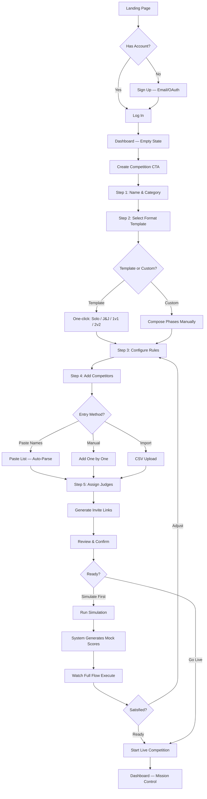
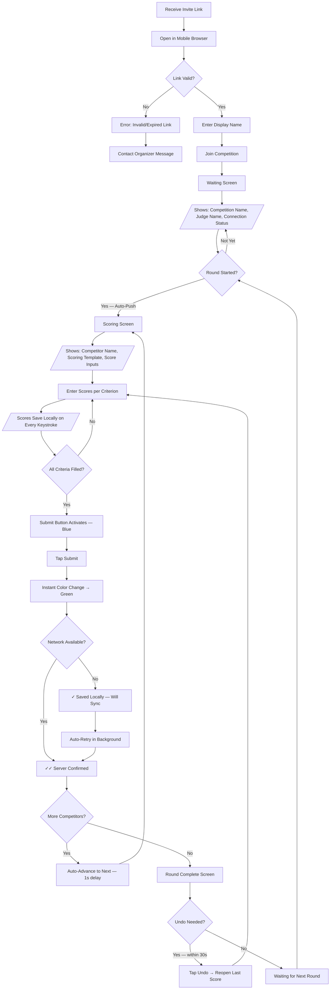
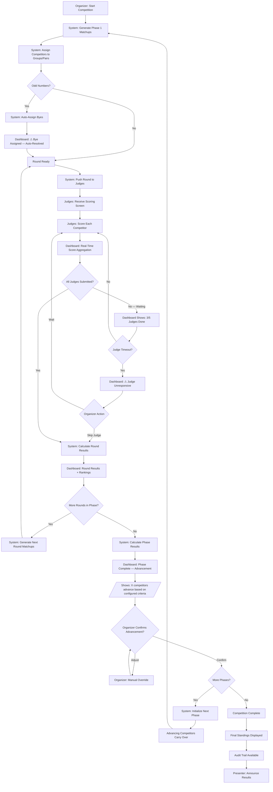
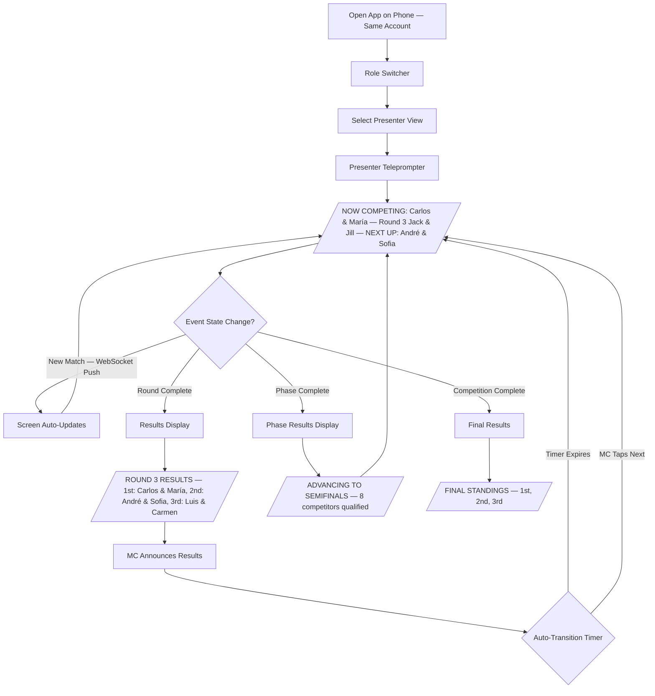
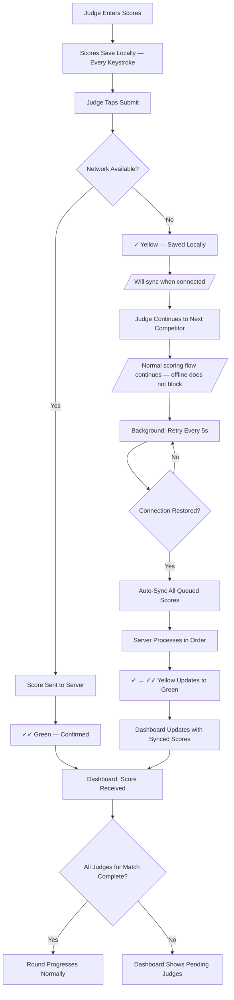

# UX Design Specification: competition-platform

**Author:** Dragonarka
**Date:** 2026-03-30

---

## Executive Summary

### Project Vision

competition-platform replaces the spreadsheets, WhatsApp groups, and manual bracket management that competition organizers currently rely on during live events. Born from the dance competition world — where Solo, Couples, Jack & Jill, and hybrid formats coexist within a single event — the platform automates match generation, scoring collection, bracket progression, and tournament state management in real-time.

The UX must serve three fundamentally different interaction models within the same system: an organizer controlling complex operations under pressure, judges submitting scores with zero friction under time constraints, and a presenter announcing the competition flow from a mobile device — often the same person as the organizer, logged in on a second device.

### Target Users

**Elena — The Organizer (Primary)**
Runs 6–8 events per year, from 4-person training sessions to 700-person international congresses. During live events, Elena operates in dual-device mode: laptop as admin (full control panel) and phone as presenter (MC teleprompter showing current/next competition). For small events, she runs the entire system solo — acting as organizer, judge, and presenter from the admin panel. Her success metric: "I didn't have to touch anything" when the automation works.

**Marco / Lucía — The Judges (Critical UX)**
Range from experienced professionals (15+ events/year, fast and confident) to first-time volunteers (need zero-training interface). Primarily mobile, mostly stationary but sometimes moving. Must submit scores within seconds of a performance ending — rounds can be as short as 30 seconds. The "Lucía test" is the UX quality gate: a volunteer judge with zero training scores a round in under 2 minutes.

**André / Mia — The Competitors (MVP: Passive)**
Not a primary UX focus for MVP. Competitors consume information (standings, upcoming matches) but don't produce it. The competitor view is read-only and informational.

**The Presenter (Organizer Dual-Role)**
A dedicated mobile view for the MC/announcer — typically the organizer logged in on a second device. Shows: current competition happening now, what's next, competitor names for announcement. Stripped-down, large-text, glanceable. Must stay in real-time sync with the admin view.

### Key Design Challenges

1. **Dual-device organizer workflow** — Admin (laptop) and Presenter (mobile) are the same person operating simultaneously. Real-time sync is mandatory. The presenter view must be a distraction-free teleprompter, not a second admin panel.

2. **Sub-10-second scoring flow** — With rounds as short as 30 seconds, judges must complete the full score-submit cycle in under 10 seconds using one thumb. No navigation steps, no scrolling, no confirmation dialogs that block.

3. **Variable physical conditions** — Lighting ranges from bright to dim. Judges may be stationary or moving. Touch targets must be oversized (56px+), contrast must exceed WCAG AAA (7:1), and submission feedback must be visual + haptic.

4. **Connection trust** — Venue Wi-Fi is unreliable. Users must never wonder "did it go through?" Every submission needs a clear three-state indicator: sending → confirmed → queued (offline, will retry).

5. **Minimal cognitive load under pressure** — The organizer is stressed, the judge is time-pressured, the presenter is performing live. Every screen must answer one question clearly, not present options to evaluate.

### Design Opportunities

1. **Zero-training judge interface** — If the Lucía test is met, judges become the platform's evangelists. The scoring interface should feel as simple as rating an Uber ride.

2. **Presenter mode as differentiator** — No competing platform offers a dedicated MC/presenter view. This is a demo-worthy, word-of-mouth feature.

3. **Calm dashboard pattern** — The organizer dashboard should surface only what needs attention (current round, next action, problems). A quiet dashboard means everything is working. This reduces stress and builds trust.

4. **Simulation as onboarding** — New organizers learn by running a full simulation before their first live event. The UX for simulation and live should be identical — no separate "training mode" interface.

## Core User Experience

### Defining Experience

The platform has three distinct core loops, each critical, but with a clear
priority hierarchy:

**Priority 1: Judge Scoring (the heartbeat)**
Every competition lives or dies by scores flowing in. The judge scoring loop
is the most repeated, most time-pressured, and most failure-sensitive action
in the system. A single stalled judge stalls the entire event. The scoring
interface must be: see competitors → input scores → submit → see confirmation
→ next competitor. Scores must be persisted locally on the device at all
times — if the network fails, the app crashes, or the browser closes, no
entered score is ever lost. Retry and sync happen automatically when
connectivity returns.

**Priority 2: Organizer Monitoring (the command center)**
During a live event, Elena needs full situational awareness. The organizer
dashboard is a mission control — data-rich, everything visible, with clear
status hierarchy. Current round, all judge submission states, next round
readiness, problem flags, competitor counts, phase progression. Elena should
be able to glance at the screen and know the full state of the competition
in under 3 seconds.

**Priority 3: Competition Setup (the on-ramp)**
Creating a competition should feel guided but powerful. A step-by-step wizard
where each step is visual and composable: select format → configure rules →
add phases → review → start. Common configurations (Solo, Jack & Jill, 1v1)
should be one-click templates. Custom composition available for advanced
organizers. Target: <5 minutes from "new competition" to "ready to start."

### Platform Strategy

| Context                              | Device                 | Input             | View                                                                    |
| ------------------------------------ | ---------------------- | ----------------- | ----------------------------------------------------------------------- |
| **Admin (Organizer)**                | Laptop/desktop primary | Mouse + keyboard  | Mission control dashboard — full data, all panels                       |
| **Presenter (Organizer dual-login)** | Mobile phone           | Touch, glanceable | Teleprompter — current/next competition, competitor names, large text   |
| **Judge**                            | Mobile phone           | One-thumb touch   | Single-purpose scoring screen — current competitors + score inputs only |
| **Competitor**                       | Mobile phone           | Read-only         | Standings, upcoming matches, results (MVP: passive consumption)         |

**Platform: Web application (responsive)**

- No native app for MVP — web app accessed via browser
- Mobile views optimized for touch (56px+ targets, high contrast)
- Desktop view optimized for mouse + keyboard (admin dashboard)
- Offline-capable scoring via local storage + Service Worker retry queue
- WebSocket real-time sync across all connected devices

### Effortless Interactions

**Must be effortless (zero thought required):**

- Judge submits a score → instant visual confirmation, auto-advance to next
  competitor. No "are you sure?" dialogs blocking the flow.
- Scores persist locally the moment they are entered — before submission.
  Network failure, app crash, browser close: scores survive. Sync is automatic.
- Organizer sees a problem → the dashboard highlights it. No hunting through
  data to find what's wrong.
- Presenter view updates in real-time → MC never announces stale information.
- Phase transitions happen automatically → when all scores are in and
  advancement criteria are met, the system progresses. Elena confirms, not
  constructs.

**Must be automated (no human intervention):**

- Match generation and bracket progression
- Odd-number handling (byes, rotation)
- Score aggregation and ranking calculation
- Phase transition when conditions are met (with organizer confirmation gate)
- Judge assignment to current round/competitors

### Critical Success Moments

1. **"It just worked" moment** — Elena's first Jack & Jill round with odd
   numbers auto-resolves. She watches from her laptop. Nothing to fix. This
   is the moment she becomes an advocate.

2. **"It went through" moment** — Marco submits a score during a Wi-Fi drop.
   The interface shows "queued — will sync." Wi-Fi returns. Score appears
   confirmed. He never had to think about it.

3. **"I didn't need training" moment** — Lucía opens the judge interface for
   the first time. She sees one competitor, a score template, and a submit
   button. She scores her first round without asking anyone for help.

4. **"I can see everything" moment** — Elena glances at her mission control
   mid-event. Current round: 3 of 5 judges submitted. Next round: ready.
   No problems. She takes a breath.

5. **"It's the same as practice" moment** — Elena ran a simulation last week.
   Today's live event looks identical. No surprises. The simulation was the
   real training.

### Experience Principles

1. **Scores are sacred** — No entered score is ever lost. Local persistence
   first, network sync second. The system treats every score as irreplaceable
   data. This is the non-negotiable foundation.

2. **One screen, one job** — Each view answers exactly one question. The judge
   screen asks "what's your score?" The presenter screen says "here's what's
   happening." The admin dashboard says "here's everything." No view tries to
   do two things.

3. **Silence means success** — The absence of alerts, warnings, and
   interventions means the system is working. Notifications exist only for
   problems and required decisions. A quiet dashboard is a successful dashboard.

4. **Speed is respect** — Every second a judge waits is a second the event
   stalls. Every second a competitor waits is a second of anxiety. The system
   must be faster than the humans using it — scores confirmed before the judge
   looks up, brackets updated before the organizer checks.

5. **Complexity is the system's problem** — Odd-number handling, format
   transitions, score aggregation, bracket math — users never see this. They
   see results. The platform absorbs complexity so humans don't have to.

## Desired Emotional Response

### Primary Emotional Goals

| User                        | Primary Emotion                                       | Secondary Emotion                                      | Anti-Emotion (avoid)                          |
| --------------------------- | ----------------------------------------------------- | ------------------------------------------------------ | --------------------------------------------- |
| **Elena (Organizer)**       | Confident control — "I know exactly what's happening" | Relief — "the system is handling it"                   | Panic — "I don't know what's going wrong"     |
| **Marco (Expert Judge)**    | Invisible efficiency — "I just scored, done, next"    | Professional trust — "this tool respects my workflow"  | Friction — "why is this taking so long?"      |
| **Lucía (Volunteer Judge)** | Reassured simplicity — "I can do this, it's obvious"  | Accomplishment — "I scored a whole round without help" | Confusion — "what am I supposed to do?"       |
| **Presenter**               | Flow state — "I always know what to say next"         | Confidence — "the info on my screen is current"        | Embarrassment — "I just announced stale info" |
| **Competitor**              | Transparency — "I know exactly where I stand"         | Trust — "the scores are fair and visible"              | Anxiety — "no one is telling me anything"     |

### Emotional Journey Mapping

**First Contact (Discovery/Signup):**
Feel: Curiosity → Clarity → "This is exactly what I needed"
The landing page and onboarding should communicate competence and simplicity. No hype, no feature overload. Show one thing: "your next competition, managed."

**First Simulation (Learning):**
Feel: Safe experimentation → Growing confidence → "I understand how this works"
Simulation mode is emotionally identical to live mode — but the stakes are zero. Elena explores freely, makes mistakes, sees how the system recovers. By the end, she feels ready.

**Pre-Event Setup:**
Feel: Guided efficiency → "That was fast" → Anticipation
Competition setup should feel like a countdown to something exciting, not like filling out tax forms. Quick, visual, composable. Under 5 minutes to "ready."

**Live Event (Peak Stress):**
Feel: Calm command → "Everything is under control"
This is the critical emotional moment. The entire platform exists to make this feel manageable. The dashboard is quiet when things work. Problems surface clearly. Judges score without friction. The organizer breathes.

**When Something Goes Wrong:**
Feel: Alert, not alarmed → "I see it, I can handle it"
Errors must never feel catastrophic. The system catches problems first (auto-handling where possible), surfaces them clearly (yellow/red status, not cryptic error messages), and provides clear resolution paths. The emotion is "I'm informed and capable," never "I'm lost."

**Post-Event:**
Feel: Accomplishment → "That was the smoothest event I've ever run"
Results are available instantly. Audit trail is complete. Elena can review everything. The emotional payoff: pride in running a professional event.

### Micro-Emotions

**Trust vs. Skepticism** — CRITICAL
Every score submission, every bracket progression, every automated decision must reinforce trust. Judges need to see their scores recorded. Organizers need to see the math is right. Competitors need to see transparent rankings. One unexplained inconsistency destroys trust for the entire event.
Design response: visible confirmation, audit trail access, score history.

**Confidence vs. Confusion** — CRITICAL
Every screen must be self-explanatory. If a user pauses to figure out what to do next, the design has failed. The judge screen has one action. The presenter screen has one message. The dashboard has one status per section.
Design response: minimal UI, clear hierarchy, no hidden actions.

**Accomplishment vs. Frustration** — IMPORTANT
Completing a round, finishing a phase, ending an event — these are moments of accomplishment. The system should acknowledge them subtly (progress indicators, completion states) without interrupting flow.
Design response: progress bars, phase completion markers, event summary.

### Design Implications

| Emotion Target           | UX Design Approach                                                                                                                                               |
| ------------------------ | ---------------------------------------------------------------------------------------------------------------------------------------------------------------- |
| **Confident control**    | Mission control dashboard with real-time status for every active element. No hidden state.                                                                       |
| **Invisible efficiency** | Judge scoring in minimal taps. Auto-advance after submission. No unnecessary confirmation dialogs.                                                               |
| **Reassured simplicity** | Large buttons, clear labels, immediate visual feedback (color change on submit).                                                                                 |
| **Trust**                | Every action has visible confirmation. Scores show "saved locally" → "synced to server" states.                                                                  |
| **Calm under pressure**  | Muted color palette. Status communicated through color (green/yellow/red), not through alerts or pop-ups. Problems surface in-place, not as interrupting modals. |
| **Safe to fail**         | Undo capability where possible. Simulation mode identical to live. Errors are recoverable, never catastrophic.                                                   |

### Emotional Design Principles

1. **Trust is built in milliseconds, destroyed in one moment** — Every interaction must reinforce reliability. Visible confirmations, consistent behavior, transparent state. The moment a user doubts whether their score was recorded or a bracket is correct, trust collapses for the entire event.

2. **Calm is a feature** — In a high-energy, high-stress live event environment, the platform is the calm center. Muted palette, clean typography, no animations that demand attention. The UI should lower cortisol, not raise it.

3. **Competence, not cleverness** — The platform should feel like a trusted professional tool, not a flashy consumer app. No gamification, no unnecessary animations, no "delightful" surprises during live events. Delight comes from reliability: "it just works, every time."

4. **Invisible when working, obvious when not** — The best emotional state during a live event is "I forgot the platform was there." When something needs attention, it becomes impossible to miss — not through alarms, but through clear visual hierarchy and status changes.

## UX Pattern Analysis & Inspiration

### Inspiring Products Analysis

**Kahoot — The Live Event Blueprint**
Kahoot is the closest UX analogue to competition-platform. It solves the same structural problem: one person controls the event (presenter/host), many people participate in real-time (players), results update live.

What it nails:

- **Join by code** — No account required for participants. Enter a PIN, you're in. Eliminates every onboarding barrier.
- **Presenter/player screen split** — The host sees the full dashboard (projector/laptop). Players see only their answer options (phone). Two completely different UIs for the same moment.
- **Countdown pressure** — A timer creates urgency. Participants know exactly how long they have. Translates directly to our scoring window.
- **Instant results** — Leaderboard updates after every question. No waiting. The dopamine of seeing your rank change in real-time.
- **One action per screen** — Players see a question and 4 colored buttons. Nothing else. Zero cognitive load.

**Slido — The Audience Interaction Model**
Slido handles live audience participation at conferences — polls, Q&A, word clouds. Relevant because it manages presenter + audience + real-time aggregation.

What it nails:

- **Admin dashboard vs. participant simplicity** — The admin panel is feature-rich (manage polls, moderate questions, view analytics). The participant view is dead simple (vote, type, submit).
- **Real-time aggregation visualization** — Results animate in as submissions arrive. The presenter sees data building live.
- **No-install mobile experience** — Works entirely in the browser. Optimized for mobile without being a native app.

**Shazam — The One-Action Interface**
Shazam is the purest single-action UI in existence: one big button, press it, get a result.

What it nails:

- **Single primary action** — The entire screen is dedicated to one thing. No navigation, no menus, no choices. This is the gold standard for our judge scoring screen.
- **Immediate feedback** — Visual animation while processing, then instant result. The user always knows the system is working.
- **Confidence through simplicity** — Even a first-time user knows exactly what to do. Zero training required. This IS the Lucía test.

**Waze — Real-Time State Under Pressure**
Waze manages real-time changing data while the user is under pressure (driving). Relevant for organizer dashboard design.

What it nails:

- **Glanceable status** — Critical info visible in 1-2 seconds without interaction. Color-coded, spatially consistent.
- **Alerts without interruption** — Warnings appear contextually, not as blocking modals. You acknowledge or ignore — either is safe.
- **Community-contributed real-time data** — Multiple inputs (drivers) aggregate into a single real-time view. Analogous to multiple judges submitting scores that aggregate into a live dashboard.

**Discord — Roles and Channels Architecture**
Discord manages complex role-based access (admin, moderator, member) across structured spaces (servers, channels). Relevant for our organizer/judge/competitor role model.

What it nails:

- **Role-based visibility** — Users see only what's relevant to their role. Admins see everything. Members see their channels. Maps directly to organizer/judge/competitor permission layers.
- **Real-time presence** — You always know who's online and active. Translates to knowing which judges are connected and submitting.
- **Server as event container** — A Discord server is conceptually similar to a competition event — a bounded space with roles, channels (phases), and real-time communication.

**Clash of Clans — Progression and State Clarity**
A strategy game with clear progression states, timers, and status indicators.

What it nails:

- **Visual state representation** — You can see the state of everything at a glance: what's building, what's ready, what needs attention. Analogous to competition phase progression.
- **Clear progression indicators** — Progress bars, timers, completion markers. Always know where you are in a process.

### Transferable UX Patterns

**Navigation Patterns:**

| Pattern                       | Source          | Application in competition-platform                                                                                                                |
| ----------------------------- | --------------- | -------------------------------------------------------------------------------------------------------------------------------------------------- |
| **Join by code**              | Kahoot          | Judges join a competition via short code or link — no account creation, no app download. Open browser, enter code, start scoring.                  |
| **Role-based views**          | Discord, Kahoot | Same URL, different experience. Organizer sees mission control. Judge sees scoring screen. Presenter sees teleprompter. Competitor sees standings. |
| **No-install web experience** | Slido, Kahoot   | Everything runs in the browser. Mobile-optimized but no app store. Reduces barrier to zero for judges at live events.                              |

**Interaction Patterns:**

| Pattern                       | Source         | Application in competition-platform                                                                                                                                 |
| ----------------------------- | -------------- | ------------------------------------------------------------------------------------------------------------------------------------------------------------------- |
| **One big action per screen** | Shazam         | Judge scoring screen: current competitor + score inputs + submit. Nothing else on screen. Shazam-level simplicity.                                                  |
| **Instant visual feedback**   | Shazam, Kahoot | Score submitted → immediate color change (gray → green). No loading spinners, no "please wait." Confirmation in <200ms.                                             |
| **Countdown/timer pressure**  | Kahoot         | Optional scoring timer for timed rounds. Judges see how long they have. Creates healthy urgency without panic.                                                      |
| **Live aggregation display**  | Slido, Waze    | Organizer dashboard shows scores arriving in real-time — like watching Slido poll results build. Each judge submission visually fills in the round status.          |
| **Glanceable alerts**         | Waze           | Problems appear as colored status badges in the dashboard, not as pop-up modals. Organizer registers "yellow flag on Round 3" in a glance, addresses it when ready. |

**Visual Patterns:**

| Pattern                    | Source               | Application in competition-platform                                                                                                                                |
| -------------------------- | -------------------- | ------------------------------------------------------------------------------------------------------------------------------------------------------------------ |
| **Color-as-status**        | Waze, Clash of Clans | Green = complete/good, yellow = attention needed, red = problem. No labels needed — color communicates instantly across language barriers.                         |
| **Progressive disclosure** | Discord              | Show the essential info first. Details available on tap/click but never cluttering the primary view. Dashboard shows round status; drill in for individual scores. |
| **Spatial consistency**    | Waze                 | Critical info is always in the same screen position. Current round: top. Judges: middle. Next round: bottom. Never moves. Builds muscle memory.                    |

### Anti-Patterns to Avoid

1. **Complex onboarding for participants** — Kahoot's genius is that players need ZERO account setup. If we require judges to create accounts, download apps, or navigate settings before scoring, we've already failed. Join link or code, name entry, done.

2. **Blocking confirmation dialogs** — "Are you sure you want to submit this score?" — No. In a 30-second round, a confirmation dialog wastes 3-5 seconds and creates doubt. Submit means submit. Undo is available for 5 seconds after, not before.

3. **Desktop-first responsive design** — Designing for desktop first and "making it responsive" produces terrible mobile experiences. Judge and presenter views must be designed mobile-first, then the admin dashboard is designed desktop-first. Two separate design tracks.

4. **Feature creep on scoring screens** — Judges don't need to see brackets, standings, or competition settings. The moment we add "helpful context" to the scoring screen, we've violated the Shazam principle. One screen, one job.

5. **Silent network failures** — The worst anti-pattern for a live event app: the user thinks their action went through but it didn't. Every submission must have visible state (sending/confirmed/queued). Borrowed from messaging apps: the checkmark pattern (sent ✓, delivered ✓✓).

6. **Data-dump dashboards** — Showing every metric on the organizer dashboard at once. Waze doesn't show traffic data for the entire city — it shows YOUR route. Elena's dashboard shows HER current competition state, not a database export.

### Design Inspiration Strategy

**Adopt Directly:**

- Kahoot's join-by-code pattern for judge onboarding
- Shazam's single-action screen principle for judge scoring
- Waze's glanceable color-coded status for organizer dashboard
- Slido's presenter/participant screen split architecture
- Messaging app checkmark pattern for submission confirmation

**Adapt for Our Context:**

- Kahoot's leaderboard animation → Competition bracket progression visualization (less playful, more professional)
- Discord's role-based channels → Role-based views within a single competition URL (same event, different experience per role)
- Clash of Clans progression states → Phase progression indicators (qualifying → semifinals → finals) with clear visual markers

**Explicitly Avoid:**

- Kahoot's gamification aesthetic (too playful for professional competitions where money is involved)
- Discord's complexity and learning curve (our judges get 0 seconds of training)
- Any pattern requiring app installation or account creation for judges/competitors

## Design System Foundation

### Design System Choice

**Primary Stack: shadcn/ui + Tremor + Framer Motion on Tailwind CSS**

A layered component architecture built on Tailwind CSS as the unified styling foundation:

| Layer                    | Library       | Role                                                                                                                                                                 |
| ------------------------ | ------------- | -------------------------------------------------------------------------------------------------------------------------------------------------------------------- |
| **Styling**              | Tailwind CSS  | Utility-first CSS framework. Single styling language across all views.                                                                                               |
| **Primitives**           | Radix UI      | Headless accessible components (underneath shadcn/ui). Handles focus management, keyboard navigation, ARIA attributes automatically.                                 |
| **General Components**   | shadcn/ui     | Buttons, forms, dialogs, navigation, cards, inputs. Copy-paste architecture — components live in the project, not in node_modules. Full ownership and customization. |
| **Dashboard Components** | Tremor        | Charts, stat cards, KPI indicators, data tables, progress bars. Purpose-built for mission control interfaces. Tailwind-native.                                       |
| **Animation**            | Framer Motion | Score submission confirmations, bracket transitions, phase progression animations, layout transitions. Gesture support for mobile touch interactions.                |

### Rationale for Selection

1. **Single styling language** — Tailwind CSS is the only styling system to learn. shadcn/ui, Tremor, and custom components all speak Tailwind. No context-switching between styling approaches.

2. **Code ownership** — shadcn/ui components are copied into the project, not imported from a package. Every component can be inspected, modified, and understood. Ideal for learning and for customizing to exact needs.

3. **Accessibility by default** — Radix UI primitives (underneath shadcn) handle keyboard navigation, screen reader support, focus trapping, and ARIA attributes. Accessibility is solved at the foundation level, not bolted on.

4. **Dashboard-ready** — Tremor provides the charts, stat cards, and data visualization components needed for Elena's mission control dashboard without building from scratch.

5. **Modern React standard** — This exact stack (shadcn + Tailwind + Framer Motion) is the dominant pattern in the React ecosystem in 2025-2026. Skills transfer directly to other projects and job opportunities.

6. **Minimal by default** — shadcn/ui's default aesthetic is clean, professional, and minimal — aligned with the "minimal & functional" design direction without additional theming work.

### Implementation Approach

**Component Strategy by View:**

| View                                | Primary Library     | Key Components                                                                                    |
| ----------------------------------- | ------------------- | ------------------------------------------------------------------------------------------------- |
| **Judge Scoring (mobile)**          | shadcn/ui           | Large number inputs, submit button, status badges, score cards                                    |
| **Organizer Dashboard (desktop)**   | Tremor + shadcn/ui  | Stat cards, progress charts, status indicators, data tables, real-time score aggregation displays |
| **Presenter Teleprompter (mobile)** | shadcn/ui (minimal) | Large text display, competitor name cards, phase indicator                                        |
| **Competition Setup (desktop)**     | shadcn/ui           | Form wizard, select menus, format configuration cards, step indicators                            |
| **Competitor View (mobile)**        | shadcn/ui + Tremor  | Standings table, bracket visualization, match cards                                               |

**Animation Strategy:**

| Interaction                   | Animation Type                                       | Library                                  |
| ----------------------------- | ---------------------------------------------------- | ---------------------------------------- |
| Score submission confirmation | Color flash (gray → green) + subtle scale            | Framer Motion                            |
| Score sync status             | Checkmark appear animation (✓ → ✓✓)                  | Framer Motion                            |
| Bracket progression           | Layout transition with shared element animation      | Framer Motion layoutId                   |
| Phase transition              | Slide/fade between phase views                       | Framer Motion AnimatePresence            |
| Dashboard data updates        | Number counting animation for live score aggregation | Framer Motion + React Spring (if needed) |
| List reordering (standings)   | Auto-animate position changes                        | Framer Motion layout                     |

### Customization Strategy

**Design Tokens (Tailwind Config):**

The following tokens will be customized from shadcn/ui defaults to match the competition-platform brand:

- **Colors:** Muted, professional palette. Status colors (green/yellow/red) are sacred and never used for branding — only for system state.
- **Typography:** Clean sans-serif. Large sizes for mobile views (judge, presenter). Dense sizes for dashboard data.
- **Spacing:** Generous on mobile (touch targets 56px+). Compact on desktop dashboard (information density).
- **Border radius:** Minimal — subtle rounding, not pill-shaped. Aligns with professional/functional aesthetic.
- **Shadows:** Minimal to none. Flat design with color/border differentiation rather than elevation. Exception: modals and overlays for depth.

**Dark Mode:**

- Support from day one (Tailwind + shadcn make this near-free)
- Critical for venue environments with variable lighting
- Judge and presenter views should default to dark mode for dim venues
- Admin dashboard follows system preference

**Responsive Breakpoints:**

- Mobile-first for judge, presenter, competitor views
- Desktop-first for admin dashboard
- No tablet-specific designs for MVP — tablet uses mobile or desktop layout based on orientation

## Defining Experience

### The Core Loop

competition-platform's defining experience is not a single interaction but a **real-time feedback loop** across three simultaneous users:

**"Everyone sees what's happening, the moment it happens."**

| User                   | Their defining moment     | What they'd tell a friend                                                                      |
| ---------------------- | ------------------------- | ---------------------------------------------------------------------------------------------- |
| **Judge (Marco)**      | "Score and go"            | "I just tap scores and submit — it takes 5 seconds, and I never worry if it went through"      |
| **Organizer (Elena)**  | "Set it and watch it run" | "I configured the competition, hit start, and the system ran the whole thing — I just watched" |
| **Competitor (André)** | "See your results live"   | "The second the judges finished scoring, I saw my ranking update on my phone"                  |

The magic is that these three moments are **the same moment** — the judge submits, the organizer's dashboard updates, the competitor's standings change. One action, three simultaneous experiences. This is what no spreadsheet, WhatsApp group, or manual process can replicate.

### User Mental Models

**Elena (Organizer) — "I'm running a show"**
Elena's mental model is a live event director. She thinks in terms of: what's happening now, what's next, what could go wrong. Her current tools (spreadsheets) force her to be both the director AND the production crew — she makes decisions AND executes them manually. The platform's shift: Elena becomes a director only. The system is her crew. She monitors, decides, and intervenes when needed — but routine operations (matchups, score math, bracket progression) happen automatically.

**Marco (Judge) — "I'm rating performances"**
Marco's mental model is simple: watch performance → form opinion → record score. His current tools (paper, WhatsApp, Google Sheets) force him to think about the recording mechanism instead of the performance. The friction is never in the judging — it's in the submission. The platform's shift: the submission mechanism disappears. The interface is so simple that Marco's attention stays on the dancers, not the tool. Score entry becomes muscle memory.

**Lucía (Volunteer Judge) — "Tell me what to do"**
Lucía has no mental model for judging software. She brings the mental model of a simple rating app (like rating an Uber ride or a restaurant). One thing to evaluate, one way to express her opinion, one button to submit. The platform's shift: meet Lucía's existing mental model exactly. Don't teach her a new one. If the interface looks like "rate this 1-10," she already knows how it works.

**André (Competitor) — "Where do I stand?"**
André's mental model is a scoreboard. He checks it, sees his position, and either feels good or knows he needs to perform better. His current tools (paper brackets on walls, delayed spreadsheet results) create information gaps that breed anxiety and distrust. The platform's shift: the scoreboard is always live. André checks his phone and sees his position updated in real-time. No information gaps, no waiting, no "did they post results yet?"

### Success Criteria

**"Score and go" (Judge) succeeds when:**

- Judge completes full scoring cycle in <10 seconds
- Zero training needed for first-time volunteer judges (Lucía test)
- Judge never wonders "did my score go through?" — visible confirmation every time
- Scores persist locally even if network fails — judge never re-enters a score
- Judge's attention stays on performances, not on the tool

**"Set it and watch it run" (Organizer) succeeds when:**

- Elena configures a competition in <5 minutes using templates
- During a live event, Elena intervenes only for exceptional decisions, not routine operations
- The dashboard tells Elena the full state of the competition in a 3-second glance
- Odd-number handling, matchup generation, and bracket progression happen automatically without Elena touching anything
- Simulation mode lets Elena rehearse the entire event beforehand

**"See your results live" (Competitor) succeeds when:**

- Results appear within 10 seconds of the last judge submitting
- André sees his ranking, upcoming matches, and completed results on one screen
- Mia (first-timer) understands where she stands without needing to understand bracket terminology
- No information is withheld — full transparency at all times

### Novel UX Patterns

**Established patterns we adopt:**

- Rating interface (1-10 scale) — universal mental model from app stores, ride-sharing, restaurants
- Join by code — proven by Kahoot, Slido, Zoom
- Real-time dashboard — established pattern from mission control, analytics tools, Grafana
- Bracket visualization — universal in sports and competition contexts
- Checkmark confirmation (✓ sent, ✓✓ confirmed) — proven by WhatsApp, iMessage

**Novel combination we create:**

- **Simultaneous three-view real-time sync** — Same event, three completely different interfaces (judge/organizer/competitor), all updating from the same real-time data stream. This combination doesn't exist in current competition platforms.
- **Presenter as a first-class view** — No platform treats the MC/announcer as a distinct user with a dedicated interface. This is genuinely new.
- **Simulation-to-live identity** — The simulation experience IS the live experience. No mode switching, no separate interface. The organizer "goes live" by inviting real judges instead of scoring herself. The learning curve for live = zero because she already ran it in simulation.

### Experience Mechanics

#### Judge Scoring Flow ("Score and go")

```
1. INITIATION
   Judge opens invite link on phone → enters name → sees scoring screen
   (No account creation. No app download. 15 seconds from link to ready.)

2. WAITING STATE
   Screen: "Waiting for next round..."
   Shows: competition name, judge's name, connection status indicator
   (Judge knows they're connected. Nothing to do. Relax.)

3. ROUND BEGINS (auto-pushed by system)
   Screen transitions to: competitor name(s) + scoring template
   Scoring template shows criteria defined by organizer
   Each criterion: label + number input (2-decimal precision)
   (Judge sees exactly what to evaluate. No ambiguity.)

4. SCORING
   Judge taps each criterion score using number pad or slider
   Scores save locally with every keystroke (sacred data principle)
   Running total visible but not prominent
   (Scores are being saved continuously — even before submit.)

5. SUBMISSION
   Large submit button at bottom (56px+ height, full width)
   Tap → immediate color change: gray → green
   Checkmark appears: ✓ (sent) → ✓✓ (server confirmed)
   If offline: ✓ (saved locally) + "Will sync when connected"
   Haptic feedback on submit (mobile)
   (Judge sees confirmation in <200ms. Trust reinforced.)

6. AUTO-ADVANCE
   After ✓✓ confirmed, screen auto-advances to next competitor
   If last competitor in round: "Round complete. Waiting for next round..."
   No manual navigation. No "next" button to find.
   (The flow is continuous. Judge never hunts for the next action.)

7. CORRECTION (optional, within 30-second window)
   "Undo last score" link appears for 30 seconds after submission
   Tap → score form reopens with previous values
   Resubmit follows same flow
   (Replaces blocking "are you sure?" with non-blocking undo.)
```

#### Organizer Dashboard Flow ("Set it and watch it run")

```
1. PRE-EVENT: SETUP
   Create competition → select format template (or compose custom)
   Add competitors (paste names or import)
   Configure phases and advancement rules
   Assign judges (generate invite links)
   (Wizard flow: 4-5 steps, <5 minutes for standard formats.)

2. PRE-EVENT: SIMULATION
   Hit "Simulate" → system generates mock scores
   Full bracket populates, phases transition, results appear
   Elena sees exactly how the live event will flow
   Reset and adjust if needed
   (Identical to live — she's learning the system by using it.)

3. LIVE EVENT: MISSION CONTROL
   Dashboard layout:
   ┌─────────────────────────────────────────┐
   │ CURRENT ROUND          [Phase 2 of 4]  │
   │ Round 3: Jack & Jill                    │
   │ ████████████░░░░ 3/5 judges submitted   │
   ├─────────────────────────────────────────┤
   │ JUDGES                                  │
   │ ✓✓ Marco  ✓✓ Ana  ✓ Pedro  ○ Lucía  ○ │
   ├─────────────────────────────────────────┤
   │ NEXT UP                                 │
   │ Round 4: ready (12 competitors)         │
   ├─────────────────────────────────────────┤
   │ ⚠ ATTENTION                             │
   │ Odd number in Group B — bye assigned    │
   │ to competitor #14 (auto-resolved)       │
   └─────────────────────────────────────────┘
   (3-second glance: current state, judge status, next round, problems.)

4. LIVE EVENT: PHASE TRANSITION
   All scores in → system calculates advancement
   Dashboard shows: "Phase 2 complete. 8 competitors advance to Phase 3."
   Elena reviews advancing competitors → confirms or adjusts
   Confirm → Phase 3 begins, judges get new round
   (Elena confirms, system executes. Director, not crew.)

5. POST-EVENT: RESULTS
   All phases complete → final standings displayed
   Full audit trail available (every score, every decision, timestamps)
   Export options (future: PDF, CSV)
   (Clean ending. Professional results. Trust maintained.)
```

#### Presenter Flow ("Here's what's happening")

```
1. LOGIN
   Same account as organizer, opens on phone
   Selects "Presenter View" from role switcher
   (Dedicated view, not a responsive version of the admin dashboard.)

2. ACTIVE DISPLAY
   Screen shows in large text:
   ┌─────────────────────────────────┐
   │        NOW COMPETING            │
   │                                 │
   │    Carlos & María               │
   │    Round 3 — Jack & Jill        │
   │                                 │
   │        NEXT UP                  │
   │    André & Sofia                │
   └─────────────────────────────────┘
   Auto-updates via WebSocket as organizer progresses rounds
   (MC glances at phone, knows exactly what to announce.)

3. RESULTS DISPLAY
   When round completes, presenter view shows:
   Results for current round (top 3 or full rankings)
   MC announces directly from screen
   Auto-transitions to next round info after configurable delay
```

## Visual Design Foundation

### Color System

**Philosophy:** Muted and professional. Color serves function, never decoration. The interface should feel like a trusted instrument panel — every color communicates something specific.

**Primary Palette:**

| Token              | Light Mode           | Dark Mode            | Usage                              |
| ------------------ | -------------------- | -------------------- | ---------------------------------- |
| `--background`     | `#FAFAFA` (zinc-50)  | `#09090B` (zinc-950) | Page background                    |
| `--surface`        | `#FFFFFF` (white)    | `#18181B` (zinc-900) | Cards, panels, elevated surfaces   |
| `--surface-raised` | `#F4F4F5` (zinc-100) | `#27272A` (zinc-800) | Nested cards, table rows (hover)   |
| `--border`         | `#E4E4E7` (zinc-200) | `#3F3F46` (zinc-700) | Dividers, card borders, separators |
| `--text-primary`   | `#09090B` (zinc-950) | `#FAFAFA` (zinc-50)  | Headings, primary content          |
| `--text-secondary` | `#71717A` (zinc-500) | `#A1A1AA` (zinc-400) | Labels, secondary info, timestamps |
| `--text-muted`     | `#A1A1AA` (zinc-400) | `#71717A` (zinc-500) | Placeholders, disabled text        |

**Brand Accent:**

| Token            | Value                 | Usage                                              |
| ---------------- | --------------------- | -------------------------------------------------- |
| `--accent`       | `#3B82F6` (blue-500)  | Primary actions, links, active states, focus rings |
| `--accent-hover` | `#2563EB` (blue-600)  | Hover state for accent elements                    |
| `--accent-muted` | `#DBEAFE` / `#1E3A5F` | Accent backgrounds (light/dark)                    |

Rationale: Blue is the universal "trust + professional" color. It doesn't compete with status colors (green/yellow/red) and reads well in both light and dark mode. Muted enough to not dominate the interface.

**Status Colors (Sacred — never used for branding):**

| Token              | Value                  | Meaning                                        |
| ------------------ | ---------------------- | ---------------------------------------------- |
| `--status-success` | `#22C55E` (green-500)  | Score confirmed, round complete, all good      |
| `--status-warning` | `#EAB308` (yellow-500) | Attention needed, auto-resolved issue, pending |
| `--status-error`   | `#EF4444` (red-500)    | Problem, disconnected, failed submission       |
| `--status-info`    | `#3B82F6` (blue-500)   | Informational, in-progress, neutral status     |
| `--status-offline` | `#A1A1AA` (zinc-400)   | Not connected, queued, waiting                 |

**Judge Scoring States (critical path):**

| State                   | Color                           | Visual                                        |
| ----------------------- | ------------------------------- | --------------------------------------------- |
| Not scored              | `--border` (zinc-200/700)       | Empty input, neutral border                   |
| Score entered (unsaved) | `--accent` (blue-500)           | Blue border/highlight — data captured locally |
| Submitting              | `--accent` + pulse animation    | Blue with subtle pulse — in transit           |
| Confirmed (✓✓)          | `--status-success` (green-500)  | Green checkmark, green border flash           |
| Queued offline (✓)      | `--status-warning` (yellow-500) | Yellow checkmark — saved, will sync           |
| Failed                  | `--status-error` (red-500)      | Red indicator — retry automatically           |

**Dark Mode Strategy:**

- Dark mode is the DEFAULT for judge and presenter views (venue lighting)
- Admin dashboard respects system preference
- Toggle available in all views
- All colors tested at WCAG AA minimum (4.5:1 contrast for text)
- Status colors adjusted for dark backgrounds to maintain readability

### Typography System

**Primary Font: Inter**
The industry standard for professional, data-dense interfaces. Used by Linear, Vercel, GitHub, Figma. Optimized for screen readability at all sizes, with excellent number legibility — critical for score displays.

**Monospace Font: JetBrains Mono**
For score values, numeric data, competitor numbers, and code-like identifiers. Tabular figures ensure numbers align perfectly in columns and score displays.

**Type Scale (tight, efficient):**

| Token              | Size | Weight    | Line Height | Usage                                      |
| ------------------ | ---- | --------- | ----------- | ------------------------------------------ |
| `--text-xs`        | 11px | 400       | 16px        | Timestamps, metadata, fine print           |
| `--text-sm`        | 13px | 400       | 18px        | Secondary labels, table cells, helper text |
| `--text-base`      | 14px | 400       | 20px        | Body text, form labels, primary content    |
| `--text-lg`        | 16px | 500       | 24px        | Card titles, section labels                |
| `--text-xl`        | 18px | 600       | 28px        | Page section headings                      |
| `--text-2xl`       | 24px | 700       | 32px        | Page titles, dashboard headers             |
| `--text-3xl`       | 30px | 700       | 36px        | Presenter view — competition name          |
| `--text-score`     | 48px | 700, mono | 1           | Score display (judge input, results)       |
| `--text-presenter` | 64px | 700       | 1.1         | Presenter view — competitor names          |

Notes:

- Base size is 14px (not 16px) — tighter for data-dense admin dashboard
- Judge mobile view overrides to 16px base for touch readability
- Presenter view uses 64px+ for glanceability from a distance
- All scores rendered in JetBrains Mono with tabular figures
- Font weight 500+ for anything that needs to be read at a glance

### Spacing & Layout Foundation

**Base Unit: 4px**
All spacing derives from a 4px grid. This creates a tight, efficient layout while maintaining visual rhythm.

**Spacing Scale:**

| Token       | Value | Usage                                          |
| ----------- | ----- | ---------------------------------------------- |
| `--space-1` | 4px   | Inline element gaps, icon padding              |
| `--space-2` | 8px   | Between related elements (label + input)       |
| `--space-3` | 12px  | Card internal padding (compact)                |
| `--space-4` | 16px  | Card internal padding (standard), section gaps |
| `--space-5` | 20px  | Between cards, major section gaps              |
| `--space-6` | 24px  | Page section separation                        |
| `--space-8` | 32px  | Major layout divisions                         |

**Layout Strategy by View:**

**Admin Dashboard (Desktop-first, tight):**

- 12-column grid, 16px gutters
- Sidebar navigation: 240px fixed width, collapsible to 56px (icons only)
- Main content: fluid, max-width 1440px
- Cards: 12px internal padding, 8px gap between cards
- Tables: 32px row height, 8px cell padding
- Dense but never cramped — clear visual grouping through borders and subtle background differences, not whitespace

**Judge Scoring (Mobile-first, generous touch targets):**

- Single column, full width
- Touch targets: minimum 56px height, full-width buttons
- Score inputs: 64px height (oversized for reliability)
- Submit button: 56px height, full width, sticky at bottom
- Spacing between score criteria: 16px
- Screen should never scroll during scoring — all criteria visible at once (organizer should limit template criteria count accordingly)

**Presenter View (Mobile-first, large text):**

- Single column, centered text
- Massive padding: 32px+ on all sides
- Competitor names fill the screen
- No UI chrome — just content
- Background: solid dark, text: high contrast white/light

**Competitor View (Mobile-first, scannable):**

- Single column with card-based layout
- Cards for each section: current match, standings, schedule
- 16px padding, 12px gaps
- Standings table: compact rows (36px) with alternating backgrounds

**Component Sizing:**

| Component               | Height | Min Width  | Touch Target   |
| ----------------------- | ------ | ---------- | -------------- |
| Button (default)        | 36px   | 80px       | 36px           |
| Button (mobile primary) | 56px   | full width | 56px           |
| Input (default)         | 36px   | 200px      | 36px           |
| Input (score, mobile)   | 64px   | 80px       | 64px           |
| Table row               | 32px   | —          | 32px           |
| Nav item                | 36px   | —          | 36px           |
| Status badge            | 24px   | 24px       | —              |
| Icon button             | 32px   | 32px       | 44px (padding) |

### Accessibility Considerations

**Contrast Requirements:**

- All text meets WCAG AA minimum (4.5:1 for normal text, 3:1 for large)
- Status colors tested on both light and dark backgrounds
- Judge scoring view targets WCAG AAA (7:1) — variable venue lighting
- Never rely on color alone — status always has icon or text label backup

**Touch Accessibility:**

- Minimum touch target: 44px (WCAG 2.1), our target: 56px on mobile
- Touch targets never overlap or sit adjacent without 8px minimum gap
- No hover-only interactions — everything accessible via tap/click

**Motion Accessibility:**

- All animations respect `prefers-reduced-motion` media query
- Score confirmation feedback has non-animated fallback (color change only)
- No auto-playing animations that could distract judges

**Internationalization:**

- All text containers use flexible widths (Spanish text is ~30% longer than English)
- Right-to-left layout support designed into grid system (future-ready)
- Numbers use locale-appropriate formatting (decimal separator)
- Font stack includes fallbacks for Latin extended character support

## Design Direction Decision

### Design Directions Explored

Three directions were generated and compared across all key views (admin dashboard, judge scoring, presenter):

| Direction                 | Description                                                                                                                     | Explored |
| ------------------------- | ------------------------------------------------------------------------------------------------------------------------------- | -------- |
| **A: Control Room**       | Dark, ultra-dense, icon-only sidebar (56px), zinc palette, blue accent. Grafana/Linear inspired. Maximum information-per-pixel. | Selected |
| **B: Warm Ops**           | Dark, stone palette, amber accent, labeled sidebar (220px). Same density as A but warmer personality.                           | Reviewed |
| **C: Light Professional** | Light mode, white cards on gray, labeled sidebar (240px), traditional SaaS aesthetic.                                           | Reviewed |

Interactive mockups: `_bmad-output/planning-artifacts/ux-design-directions.html`

### Chosen Direction

**Direction A: Control Room**

- **Sidebar:** Icon-only, 56px width, collapsible. Maximizes main content area for dashboard panels. Icons for: Dashboard, Competitions, Competitors, Judges, Settings.
- **Color temperature:** Cool zinc (neutral gray) — professional, technical, doesn't compete with status colors.
- **Accent:** Blue (#3B82F6) — trust, professional, universal.
- **Density:** Maximum. 32px table rows, 12px card padding, 8px gaps. Information-rich without being cluttered.
- **Dark mode native:** The default theme is dark. Light mode available as toggle but dark is primary — matches venue environments and reduces eye strain during long events.
- **Judge scoring:** Dark background, high-contrast inputs, blue borders for active/filled states, green for confirmed. Oversized touch targets on dark canvas.
- **Presenter:** Pure dark background, white text, zero chrome. Maximum readability from any angle.

### Design Rationale

1. **Mission control demands density** — Elena needs to see current round, judge status, next round, alerts, and phase progression simultaneously. The icon sidebar gives 184px more horizontal space than Direction B's labeled sidebar — significant on a laptop screen.

2. **Dark mode is the natural default** — Competitions happen in venues with variable lighting. A dark interface reduces glare, extends battery life on mobile devices, and creates less visual distraction in dim environments. Judges and presenters benefit most.

3. **Cool palette preserves status color clarity** — Zinc grays are perfectly neutral. Status colors (green/yellow/red) stand out clearly without competing with warm tones. In Direction B, the amber accent created subtle tension with the yellow warning color.

4. **Professional, not playful** — Direction A feels like a trusted instrument panel. This matches the emotional design principle "competence, not cleverness" and reinforces trust when money is involved in competition outcomes.

### Implementation Approach

**Phase 1: Core Components**
Build the foundational components using shadcn/ui with zinc palette:

- Button variants (primary/blue, secondary/zinc, destructive/red)
- Input fields (default, score-input/oversized, search)
- Status badges (success, warning, error, info, offline)
- Cards (panel, stat-card, alert-card, competitor-card)
- Navigation (icon sidebar, mobile bottom nav)

**Phase 2: View-Specific Layouts**
Assemble components into the four primary views:

- Admin dashboard (12-column grid, sidebar + panels)
- Judge scoring (single column, mobile-first, sticky submit)
- Presenter teleprompter (centered, large text, zero chrome)
- Competitor standings (card-based, mobile-first)

**Phase 3: Real-Time States**
Add dynamic states using Framer Motion:

- Score submission flow (neutral → blue → green/yellow)
- Judge status updates (dots + checkmarks animating)
- Dashboard data refresh (number transitions, progress bars)
- Phase progression indicators (animated step markers)

**Tailwind Configuration:**

```css
/* tailwind.config.ts — Direction A: Control Room */
colors: {
  background: "hsl(240 10% 3.9%)",    /* zinc-950 */
  foreground: "hsl(0 0% 98%)",         /* zinc-50 */
  card: "hsl(240 10% 3.9%)",           /* zinc-900 */
  "card-foreground": "hsl(0 0% 98%)",
  primary: "hsl(217.2 91.2% 59.8%)",   /* blue-500 */
  "primary-foreground": "hsl(0 0% 100%)",
  secondary: "hsl(240 3.7% 15.9%)",    /* zinc-800 */
  muted: "hsl(240 3.7% 15.9%)",
  "muted-foreground": "hsl(240 5% 64.9%)", /* zinc-400 */
  accent: "hsl(240 3.7% 15.9%)",
  destructive: "hsl(0 84.2% 60.2%)",   /* red-500 */
  border: "hsl(240 3.7% 15.9%)",       /* zinc-800 */
}
```

## User Journey Flows

### Journey 1: Organizer First Event Setup

**Goal:** Elena goes from signup to running her first competition
**Entry:** Landing page or referral link
**Success:** Competition running with judges scoring live



**Key UX Decisions:**

- Empty state dashboard has a single prominent "Create Competition" CTA
- Format templates are one-click presets — Solo, Jack & Jill, 1v1 Group, 2v2 Leader/Follower. Custom composition available but not the default path.
- Competitor entry supports paste (most common: copy from spreadsheet), manual add, and CSV import
- Simulation is offered before going live but not mandatory — experienced organizers can skip
- The wizard is linear (5 steps) but each step is editable after completion via back navigation

**Steps to value:** 5 wizard steps, estimated <5 minutes for template-based setup. Simulation adds 2-3 minutes but builds critical confidence.

### Journey 2: Judge Join & Score

**Goal:** Marco joins a competition and scores a round
**Entry:** Invite link from organizer (SMS, WhatsApp, email)
**Success:** All scores submitted, round complete



**Key UX Decisions:**

- No account creation. No app download. Name entry only.
- Invite link is the entire onboarding — one URL, open in browser, go.
- Scores persist locally on every keystroke (not just on submit) — sacred data principle
- Submit button only activates when all criteria are filled — prevents incomplete submissions
- Auto-advance after confirmation (1s delay) eliminates "what's next?" thinking
- 30-second undo window replaces blocking "are you sure?" dialog
- Offline path is transparent: yellow checkmark + "will sync" message

**Time to first score:** <15 seconds from opening invite link
**Full scoring cycle:** <10 seconds per competitor

### Journey 3: Live Event Full Lifecycle

**Goal:** Complete competition from start to final results
**Entry:** Organizer clicks "Start Competition"
**Success:** Final standings displayed, all scores auditable



**Key UX Decisions:**

- Matchup generation is fully automatic — organizer doesn't choose who faces whom
- Odd-number handling auto-resolves with a dashboard notification (not a blocking dialog)
- Judge timeout surfaces as a warning, not an error — organizer decides whether to wait or skip
- Phase advancement requires organizer confirmation — this is the "director confirms, system executes" pattern
- Manual override available for advancement (Elena can include/exclude specific competitors) but system recommendation is the default
- Competitor data carries across phases — scores, rankings, and identity persist

### Journey 4: Presenter MC Flow

**Goal:** MC announces competition in real-time from mobile
**Entry:** Organizer logs in on second device
**Success:** All announcements made with current information



**Key UX Decisions:**

- Presenter view is accessed via role switcher on the same account — not a separate login
- All updates arrive via WebSocket — presenter never refreshes or polls
- Auto-transition timer between results and next match info (configurable by organizer: 10s, 20s, 30s)
- MC can manually tap to advance if they're ready before the timer
- Text is large (64px+ competitor names) for glanceability while presenting
- Zero UI chrome — no sidebars, no menus, no buttons except minimal navigation. Pure content.

### Journey 5: Error Recovery — Offline Judge

**Goal:** Judge's score submission survives network failure
**Entry:** Judge submits score but network is unavailable
**Success:** Score syncs when connection returns, no data lost



**Key UX Decisions:**

- Offline NEVER blocks the judge — they continue scoring the next competitor immediately
- The visual state change (yellow → green) happens in the background as scores sync — judge doesn't need to do anything
- Retry is automatic every 5 seconds — no "retry" button needed
- Queued scores sync in order when connection returns — preserving the scoring timeline
- Dashboard shows delayed scores arriving (Elena sees them populate) with a brief "synced" indicator
- If the judge closes the browser entirely, scores are in localStorage and sync on next visit (within session)

### Journey Patterns

**Pattern: Status Lifecycle**
Used across all views for any stateful action:

`○ Waiting → ✓ In Progress/Local → ✓✓ Confirmed → ✓ Complete`

Colors: `zinc-500 → blue-500 → green-500 → green-500`

Applied to: score submission, judge status, round progress, phase transitions, connection state.

**Pattern: Auto-Advance**
After a confirmed action, the system automatically advances to the next step without user intervention:

- Judge: score confirmed → next competitor appears
- Organizer: round complete → next round readiness shown
- Presenter: results displayed → next match info after timer

This eliminates "what do I do now?" across all user types.

**Pattern: Graceful Degradation**
When something fails, the system:

1. Continues functioning (never blocks the user)
2. Shows clear status (what happened, what's queued)
3. Auto-recovers when possible (retry, sync)
4. Escalates to organizer only if human decision needed

Applied to: network failures, judge timeouts, odd-number handling.

**Pattern: Organizer Confirmation Gate**
The system automates operations but gates critical transitions on organizer approval:

- Phase advancement: "8 competitors advance. Confirm?"
- Format transition: "Switching to elimination bracket. Confirm?"
- Score override: "Judge submitted corrected score. Accept?"

This preserves Elena's control without requiring her to do the work.

### Flow Optimization Principles

1. **Zero-navigation scoring** — The judge never taps a navigation element during active scoring. Everything auto-advances. The entire scoring flow is: enter numbers → tap submit → repeat.

2. **One-tap recovery** — Any error state is recoverable with a single action. Undo a score: one tap. Resend a failed submission: automatic. Reconnect after offline: automatic.

3. **Progressive information disclosure** — Show the minimum needed for the current action. Judge: just the competitor and criteria. Dashboard: just the current state. Details available on drill-down, never cluttering the primary view.

4. **Parallel flows don't block** — Judges score independently. One slow judge doesn't block others from seeing their confirmation. The dashboard aggregates in real-time as each judge submits — not after all submit.

5. **State is always visible** — No hidden state anywhere. If a score is queued, it says queued. If a judge is offline, it shows offline. If a phase is 60% complete, the progress bar shows 60%. The system never says "loading" without context.

## Component Strategy

### Design System Components

**From shadcn/ui (use directly or customize):**

| Component | Usage in Platform                                 | Customization Needed                                         |
| --------- | ------------------------------------------------- | ------------------------------------------------------------ |
| Button    | Submit scores, confirm actions, wizard navigation | Score submit variant (56px height, full-width, state colors) |
| Input     | Form fields, search, text entry                   | None — use defaults                                          |
| Card      | Dashboard panels, competitor cards, stat cards    | Compact variant (12px padding) for dashboard density         |
| Badge     | Status indicators, phase labels, role tags        | Status color variants (success/warning/error/offline)        |
| Table     | Competitor lists, score history, standings        | Compact rows (32px) for dashboard                            |
| Dialog    | Confirmation gates, settings, competitor details  | Minimal — avoid during live scoring                          |
| Tabs      | Dashboard sections, competition views, settings   | None                                                         |
| Toast     | Score confirmation, sync status, error alerts     | Custom position (top-center for judge mobile)                |
| Form      | Competition setup wizard, template config         | Wizard step layout variant                                   |
| Select    | Format selection, category, phase config          | None                                                         |
| Sheet     | Mobile navigation, competitor details drill-down  | None                                                         |
| Progress  | Round progress, phase progression                 | None — use defaults                                          |
| Skeleton  | Loading states for dashboard panels               | None                                                         |
| Switch    | Dark mode toggle, setting toggles                 | None                                                         |
| Tooltip   | Icon sidebar labels, data point explanations      | None                                                         |

**From Tremor (dashboard-specific):**

| Component    | Usage in Platform                             | Customization Needed                           |
| ------------ | --------------------------------------------- | ---------------------------------------------- |
| NumberTicker | Live score aggregation, competitor counts     | Animated transitions for real-time updates     |
| ProgressBar  | Round completion (3/5 judges), phase progress | Status-colored variants                        |
| Tracker      | Judge submission timeline, round history      | Custom status colors                           |
| AreaChart    | Score distribution visualization (post-event) | Zinc/blue theme                                |
| BarChart     | Competitor rankings, score comparisons        | Horizontal variant for standings               |
| Callout      | Dashboard alerts (odd-number, judge timeout)  | Warning/info variants with auto-resolved state |

### Custom Components

#### ScoreInput — The Critical Component

**Purpose:** Judge enters a numeric score with 2-decimal precision using an on-screen number pad. This is the most-used, most time-sensitive component in the entire platform.

**Anatomy:**

```
┌─────────────────────────────┐
│  Technique           8.50   │  ← Criterion label + current value
├─────────────────────────────┤
│                             │
│    [ 1 ]  [ 2 ]  [ 3 ]     │
│    [ 4 ]  [ 5 ]  [ 6 ]     │  ← Number pad (56px buttons)
│    [ 7 ]  [ 8 ]  [ 9 ]     │
│    [ . ]  [ 0 ]  [ ⌫ ]     │
│                             │
└─────────────────────────────┘
```

**States:**
| State | Display | Border | Behavior |
|---|---|---|---|
| Empty | `0.00` placeholder, muted | zinc-700 | Awaiting input |
| Focused | Cursor active, pad visible | blue-500 | Accepting digits |
| Filled | Value displayed, bold mono | blue-500 | Data saved locally |
| Submitted | Value + ✓✓ | green-500 | Confirmed by server |
| Queued | Value + ✓ | yellow-500 | Saved locally, pending sync |
| Error | Value + retry icon | red-500 | Submission failed |

**Behavior:**

- Tap digit → appends to value (max format: XX.XX)
- Decimal point auto-inserted after 2nd digit if not manually placed
- Backspace (⌫) removes last digit
- Value saves to localStorage on every keystroke
- Number pad appears inline (not as overlay keyboard) — judge sees competitor name + criteria + pad simultaneously
- Haptic feedback on each tap (mobile)

**Variants:**

- `default` — full pad with criterion label (used in scoring screen)
- `compact` — inline display only, no pad (used in score review/history)
- `readonly` — display value only (used in results, audit trail)

**Accessibility:**

- Each button has aria-label ("digit 8", "decimal point", "backspace")
- Keyboard input supported (desktop fallback): type numbers directly
- High contrast: white digits on zinc-800 buttons, blue-500 focus ring
- Minimum button size: 56px (exceeds 44px WCAG requirement)

#### ScoreSubmitButton

**Purpose:** Single action to submit all scores for current competitor. The most important tap in the system.

**Anatomy:**

```
┌─────────────────────────────────┐
│         Submit Score            │  ← Full-width, 56px height
└─────────────────────────────────┘
```

**States:**
| State | Background | Text | Icon |
|---|---|---|---|
| Disabled (incomplete) | zinc-800 | zinc-600 | None |
| Ready | blue-500 | white | None |
| Submitting | blue-500 + pulse | white | Spinner |
| Confirmed | green-500 | white | ✓✓ |
| Queued (offline) | yellow-500 | zinc-950 | ✓ |
| Error | red-500 | white | Retry ↻ |

**Behavior:**

- Disabled until all criteria have values
- Tap → instant color change (blue → green in <200ms)
- Haptic feedback on successful submit
- After ✓✓ confirmed: auto-advance to next competitor (1s delay)
- Error state: auto-retries, tap to force retry
- Never shows a confirmation dialog

#### JudgeStatusRow

**Purpose:** Shows one judge's current status on the organizer dashboard. Repeated for each judge in the active round.

**Anatomy:**

```
● Marco                    ✓✓ Submitted    12s ago
```

**States:**
| State | Dot Color | Status Text | Detail |
|---|---|---|---|
| Waiting | zinc-600 | ○ Waiting | — |
| Connected | blue-500 | ○ Connected | — |
| Scoring | yellow-500 | ✓ Scoring... | Active |
| Submitted | green-500 | ✓✓ Submitted | Time since |
| Offline | red-500 | ⚠ Offline | Last seen |
| Syncing | yellow-500 | ✓ Syncing | Queued scores |

**Behavior:**

- Updates in real-time via WebSocket
- Dot pulses gently when status changes (Framer Motion)
- Clicking/tapping a judge row expands to show their submitted scores (progressive disclosure)
- Offline judges surface a warning — organizer can choose to wait or skip

#### ConnectionStatusBadge

**Purpose:** Persistent indicator showing the device's connection state. Visible on every view — judges, presenter, dashboard.

**Anatomy:**

```
● Connected        ● Offline — scores saved locally
```

**States:**
| State | Dot | Text | Position |
|---|---|---|---|
| Connected | green | "Connected" | Header, right-aligned |
| Reconnecting | yellow, pulsing | "Reconnecting..." | Header |
| Offline | red | "Offline — scores saved locally" | Header |
| Syncing | yellow, spinning | "Syncing 3 scores..." | Header |

**Behavior:**

- Always visible in the header area — never hidden
- Transitions animate smoothly (Framer Motion)
- Offline state reassures: "scores saved locally" (trust pattern)
- Syncing shows count of queued items

#### PhaseProgressionBar

**Purpose:** Shows competition phase progress on the organizer dashboard. Visual representation of the tournament's overall state.

**Anatomy:**

```
[████ Groups ✓] [████ J&J ●] [░░░░ Semis] [░░░░ Finals]
```

**States per segment:**
| State | Fill | Label Color | Indicator |
|---|---|---|---|
| Complete | green-500 | zinc-300 | ✓ |
| Active | blue-500 | blue-400 | ● (pulsing) |
| Upcoming | zinc-700 | zinc-600 | — |

**Behavior:**

- Horizontal bar divided into equal segments per phase
- Active phase pulses subtly
- Clicking a completed phase shows that phase's results
- Responsive: stacks vertically on mobile if needed

#### PresenterDisplay

**Purpose:** Full-screen teleprompter for the MC. Zero chrome, maximum readability.

**Anatomy:**

```
┌─────────────────────────────────┐
│                                 │
│         NOW COMPETING           │  ← 12px, uppercase, zinc-500
│                                 │
│        Carlos & María           │  ← 64px, bold, white
│                                 │
│     Round 3 — Jack & Jill       │  ← 16px, zinc-400
│                                 │
│           ─────────             │
│                                 │
│           NEXT UP               │  ← 12px, uppercase, zinc-600
│        André & Sofia            │  ← 20px, zinc-400
│                                 │
└─────────────────────────────────┘
```

**States:**
| State | Content |
|---|---|
| Active Match | Current competitors + round info + next up |
| Results | Round results (1st, 2nd, 3rd with scores) |
| Phase Transition | "Advancing to [Phase Name] — X competitors" |
| Final Results | Final standings with placements |
| Waiting | "Next round starting soon..." |

**Behavior:**

- Updates via WebSocket — never stale
- Auto-transitions between results → next match (configurable timer)
- Tap anywhere to advance manually (hidden touch target)
- Always dark mode, always full-screen
- Text sizes scale based on content length (fewer competitors = larger text)

#### CompetitorCard

**Purpose:** Displays a competitor or pair in the scoring screen, bracket view, or standings.

**Anatomy (scoring context):**

```
┌─────────────────────────────────┐
│  #7 — Jack & Jill              │  ← Match number + format
│  Carlos & María                 │  ← Names, bold, large
└─────────────────────────────────┘
```

**Variants:**

- `scoring` — centered, prominent names (judge mobile view)
- `bracket` — compact, with score and advancement indicator
- `standings` — row format with rank, name, total score

#### FormatTemplateCard

**Purpose:** Visual selector for competition format during setup wizard. One-click template selection.

**Anatomy:**

```
┌──────────────────┐
│  ♟  Solo         │
│                  │
│  Individual      │
│  competitors     │
│  scored in       │
│  groups          │
│                  │
│  [Select]        │
└──────────────────┘
```

**Variants:** Solo, Jack & Jill, 1v1 Group, 2v2 Leader/Follower, Custom
Each card has: icon, title, brief description, select button.
Selected state: blue border + checkmark.

#### AlertCard

**Purpose:** Dashboard notification for events requiring awareness or action. Non-blocking — appears inline in the alerts panel.

**Anatomy:**

```
┌─────────────────────────────────────────┐
│ ⚠  Odd number in Group B               │
│    Bye assigned to #14 (auto-resolved)  │
└─────────────────────────────────────────┘
```

**Variants:**
| Variant | Border/BG | Icon | Requires Action? |
|---|---|---|---|
| Auto-resolved | yellow/muted | ⚠ | No — informational |
| Needs attention | yellow/strong | ⚠ | Yes — organizer decision |
| Critical | red/muted | ✕ | Yes — immediate |
| Info | blue/muted | ℹ | No — informational |

### Component Implementation Strategy

**Build Order (aligned with MVP priority):**

**Sprint 1 — Judge Scoring (Priority 1):**

1. ScoreInput (number pad variant)
2. ScoreSubmitButton
3. CompetitorCard (scoring variant)
4. ConnectionStatusBadge
5. Toast (score confirmation)

**Sprint 2 — Organizer Dashboard (Priority 2):** 6. JudgeStatusRow 7. PhaseProgressionBar 8. AlertCard 9. Stat cards (Tremor customized) 10. Round progress panel (composed from Progress + Card)

**Sprint 3 — Setup & Presenter (Priority 3):** 11. FormatTemplateCard 12. Competition setup wizard (composed from Form + Tabs) 13. PresenterDisplay 14. CompetitorCard (bracket + standings variants)

**Component Architecture Principles:**

- All custom components built using shadcn/ui primitives + Tailwind
- State management via React hooks (useState/useReducer) — no external state library for UI components
- Real-time updates via WebSocket context provider
- Local persistence via localStorage wrapper (for sacred score data)
- All components support dark mode via CSS variables
- Framer Motion for state transition animations
- Every component has a Storybook entry for isolated development/testing

## UX Consistency Patterns

### Feedback Patterns

**The Checkmark Protocol (universal feedback language):**

Every user action that involves data transmission follows the same visual language across the entire platform:

| Stage        | Icon      | Color      | Meaning                       | Duration                  |
| ------------ | --------- | ---------- | ----------------------------- | ------------------------- |
| Idle         | —         | zinc-700   | No action taken               | Persistent                |
| In progress  | ○ spinner | blue-500   | Processing                    | Until resolved            |
| Sent locally | ✓         | yellow-500 | Saved on device, pending sync | Until server confirms     |
| Confirmed    | ✓✓        | green-500  | Server acknowledged           | 3s then fade to subtle    |
| Failed       | ✕         | red-500    | Submission failed             | Until auto-retry succeeds |

This protocol applies to: score submissions, competition setup saves, judge invitations, phase transitions, settings changes. Users learn the pattern once and recognize it everywhere.

**Toast Notifications:**

| Type            | Position            | Duration                  | Dismissible | Use When                      |
| --------------- | ------------------- | ------------------------- | ----------- | ----------------------------- |
| Score confirmed | Top-center (mobile) | 2s auto-dismiss           | No          | Judge submits score           |
| Error           | Top-center          | Persistent until resolved | Yes         | Network failure, server error |
| Warning         | Top-right (desktop) | 5s auto-dismiss           | Yes         | Non-blocking alerts           |
| Info            | Top-right (desktop) | 3s auto-dismiss           | Yes         | Status updates                |

**Rules:**

- Never stack more than 2 toasts simultaneously
- Toasts never appear during active scoring (judge mobile) — use inline status changes instead
- Desktop toasts appear top-right; mobile toasts appear top-center
- Success toasts are brief (2s); errors persist until resolved

**Inline vs. Toast Feedback:**

- **Inline** (preferred for critical paths): Score submission states, connection status, judge status dots. The feedback appears exactly where the user is looking.
- **Toast** (for background events): Settings saved, invite link copied, export complete. Events the user triggered but isn't staring at.

### Button Hierarchy

**Three tiers across the platform:**

| Tier        | Style                   | Height                        | Use When                                                                       |
| ----------- | ----------------------- | ----------------------------- | ------------------------------------------------------------------------------ |
| Primary     | Blue-500, solid fill    | 36px (desktop), 56px (mobile) | The ONE action on screen: Submit Score, Start Competition, Confirm Advancement |
| Secondary   | Zinc-800, subtle border | 36px                          | Supporting actions: Cancel, Back, Edit, View Details                           |
| Destructive | Red-500, solid fill     | 36px                          | Irreversible actions: Remove Competitor, Delete Competition                    |

**Rules:**

- Maximum ONE primary button visible per screen area
- Judge scoring screen: Submit Score is the only primary button
- Dashboard: primary buttons appear only for actions requiring organizer decision (Confirm Advancement, Start Round)
- Destructive actions always require a confirmation step (Dialog)
- Secondary buttons never compete with primary visually

**Button States (all tiers):**

| State          | Visual Change                           |
| -------------- | --------------------------------------- |
| Default        | Tier-appropriate fill                   |
| Hover          | Slightly darker (desktop only)          |
| Active/Pressed | Scale 0.98 + darker fill                |
| Disabled       | Zinc-800 fill, zinc-600 text, no cursor |
| Loading        | Spinner replaces text, same fill        |

**Mobile-Specific:**

- Primary buttons are always full-width on mobile
- Minimum touch height: 56px for primary, 44px for secondary
- Sticky positioning for primary actions (score submit sticks to bottom)

### Navigation Patterns

**Role-Based Navigation Architecture:**

| View            | Nav Type       | Position            | Behavior                                                                  |
| --------------- | -------------- | ------------------- | ------------------------------------------------------------------------- |
| Admin Dashboard | Icon sidebar   | Left, 56px width    | Fixed. Icons only. Tooltip on hover. Collapsible to hidden on mobile.     |
| Admin Mobile    | Bottom tab bar | Bottom, 56px height | 4-5 icons: Dashboard, Competitions, Judges, Settings                      |
| Judge Scoring   | Minimal header | Top, 48px height    | Competition name + connection badge. No navigation — flow is auto-driven. |
| Presenter       | No nav         | Hidden              | Zero chrome. Tap edge for hidden settings.                                |
| Competitor      | Bottom tab bar | Bottom, 56px height | Standings, Schedule, Results                                              |
| Setup Wizard    | Step indicator | Top, below header   | Linear: Step 1 → 2 → 3 → 4 → 5. Back navigation available.                |

**Breadcrumbs:**

- Desktop admin only: `Dashboard / Salsa Championship / Round 3`
- Never on mobile — screen space is sacred
- Max depth: 3 levels

**Back Navigation:**

- Admin: breadcrumb click or browser back
- Judge: not applicable (auto-driven flow, no pages to go back to)
- Setup wizard: explicit Back button at each step
- Presenter: tap screen edge to reveal settings

### Empty & Loading States

**Empty States (no data yet):**

| Context                      | Message                               | Action                                             |
| ---------------------------- | ------------------------------------- | -------------------------------------------------- |
| Dashboard — no competitions  | "No competitions yet"                 | Primary CTA: "Create Your First Competition"       |
| Competition — no competitors | "Add competitors to get started"      | CTA: "Add Competitors" or "Paste Names"            |
| Competition — no judges      | "Invite judges to score"              | CTA: "Generate Invite Links"                       |
| Judge — waiting for round    | "Waiting for next round..."           | Connection status badge visible. No action needed. |
| Standings — no results       | "Results will appear as judges score" | No action — informational                          |

**Rules:**

- Empty states always have a single clear CTA (what to do next)
- Illustrations: none for MVP — text + CTA is sufficient. Matches "minimal & functional" aesthetic.
- Empty states use zinc-500 text, centered in the content area

**Loading States:**

| Context                | Pattern                                 | Duration Threshold      |
| ---------------------- | --------------------------------------- | ----------------------- |
| Dashboard panels       | Skeleton (shadcn Skeleton)              | Show skeleton if >200ms |
| Score submission       | Inline spinner on button                | Immediate               |
| Page navigation        | Full skeleton layout                    | Show skeleton if >300ms |
| WebSocket reconnecting | Connection badge: yellow pulse          | Immediate               |
| Data refresh           | Subtle opacity fade (0.7) on stale data | Immediate               |

**Rules:**

- Never show a blank screen — always skeleton or previous data
- Loading spinners are inline, never full-page overlays
- If data is stale but available, show it at reduced opacity while refreshing — better than showing nothing
- Score data never shows loading state — it's always in localStorage first (sacred data principle)

### Error Recovery Patterns

**Error Severity Hierarchy:**

| Severity             | Visual                               | User Action           | System Action                                     |
| -------------------- | ------------------------------------ | --------------------- | ------------------------------------------------- |
| **Auto-recovered**   | Yellow inline badge, auto-dismisses  | None                  | System handled it (retry succeeded, bye assigned) |
| **Needs awareness**  | Yellow AlertCard in dashboard        | Acknowledge (dismiss) | System resolved but organizer should know         |
| **Needs decision**   | Yellow AlertCard with action buttons | Choose option         | System paused, waiting for organizer input        |
| **Critical failure** | Red AlertCard, persistent            | Immediate action      | System cannot continue without intervention       |

**Network Error Pattern:**

```
1. Action fails silently (user doesn't see the failure)
2. System auto-retries (up to 3 attempts, 5s intervals)
3. If retries succeed → ✓✓ confirmed (user never knew)
4. If retries fail → surface to user:
   - Judge: "✓ Saved locally — will sync when connected"
   - Dashboard: "⚠ Judge [name] scores pending — offline"
5. Continue retrying in background indefinitely
6. On success → update all indicators silently
```

**Validation Error Pattern (forms):**

- Inline validation: show error below the field, red border
- Validate on blur (not on keystroke — less disruptive)
- Submit button stays enabled — show all errors on submit attempt
- Error messages are specific: "Score must be between 0.00 and 10.00" (not "Invalid input")
- Clear error when user corrects the value

**Undo Pattern:**

- Available for: score submission (30s window), competitor removal, phase advancement (before next phase starts)
- NOT available for: competition deletion (use confirmation dialog instead), published results
- Visual: subtle "Undo" link appears near the action, auto-dismisses after time window
- Replaces "Are you sure?" dialogs for non-destructive reversible actions

### Modal & Overlay Patterns

**When to use modals (Dialog):**

- Confirmation of destructive actions (delete competition, remove judge)
- Organizer decision gates (confirm phase advancement with competitor list)
- Settings that affect the live competition

**When NOT to use modals:**

- Score submission confirmation — NEVER (inline feedback only)
- Informational messages — use toast or inline
- Navigation — use page/tab transitions
- Anything during active judge scoring — modals block the flow

**Modal Rules:**

- Always have a visible close button (X) AND a cancel action
- Primary action button right-aligned, destructive actions use red
- ESC key dismisses on desktop
- Backdrop click dismisses (unless confirmation is required)
- Max width: 480px. Content scrolls inside if needed.
- Mobile: modals become full-screen sheets (bottom slide-up)

### Search & Filtering Patterns

**Dashboard Search:**

- Single search input in header area, searches across: competitors, competitions, judges
- Results grouped by type with clear section labels
- Keyboard shortcut: Cmd+K / Ctrl+K (desktop)
- Search is fuzzy — partial matches on names

**Table Filtering:**

- Filter controls above table, inline with column headers
- Active filters show as removable badges
- "Clear all filters" action when any filter is active
- Filter state persists during the session (not across sessions)

**Competition Filtering:**

- By status: Active, Completed, Draft, Simulation
- By format: Solo, J&J, 1v1, 2v2, Custom
- By date: Date range picker

### Internationalization Patterns

**Language Switching:**

- Toggle in user settings (persistent preference)
- Available: Spanish (ES) and English (EN) for MVP
- Language switch takes effect immediately — no page reload
- All UI text from i18n keys, never hardcoded strings

**Content Handling:**

- Spanish text is ~30% longer than English — all containers use flexible widths, never fixed
- Number format: locale-aware (1,234.56 EN vs 1.234,56 ES)
- Date format: locale-aware (MM/DD/YYYY EN vs DD/MM/YYYY ES)
- Competitor names, competition names, category names are user-entered and never translated — displayed as-is in any locale

---

## Responsive Design & Accessibility

### Responsive Strategy

**Three distinct device experiences — not one responsive design:**

| Role       | Primary Device   | Strategy                                             |
| ---------- | ---------------- | ---------------------------------------------------- |
| Organizer  | Laptop (1024px+) | Mission Control — dense, multi-column, data-rich     |
| Presenter  | Mobile (375px)   | Teleprompter — single column, large text, glanceable |
| Judge      | Mobile (375px)   | Single-action — full-screen score pad, no navigation |
| Competitor | Any              | Read-only — responsive card list, no interaction     |

The organizer on mobile (admin panel on phone) gets the simplified presenter view by default, with an explicit "Admin Mode" toggle to access the full control panel at reduced density.

**Mobile-first approach**: All layouts start from 375px and progressively enhance. No feature exists on desktop that is unavailable on mobile — it may just be restructured.

### Breakpoint Strategy

```
xs:  320px  — Small phones (Samsung Galaxy S5, iPhone SE gen1)
sm:  375px  — Standard mobile (iPhone 14, Pixel 7) — PRIMARY DESIGN TARGET
md:  768px  — Tablets (iPad, Surface Go)
lg:  1024px — Laptop/desktop — PRIMARY ADMIN TARGET
xl:  1440px — Large desktop / multi-monitor organizer setups
```

**Tailwind breakpoint config (extends defaults):**

```js
screens: {
  'xs': '320px',   // min viable — verify critical paths
  'sm': '375px',   // default mobile breakpoint
  'md': '768px',   // tablet
  'lg': '1024px',  // desktop admin
  'xl': '1440px',  // large desktop
}
```

**Layout behavior by breakpoint:**

- **Judge view**: Single column at all breakpoints. Number pad grows to fill available space up to 400px max-width, then centers. Never goes multi-column.
- **Presenter view**: Single column always. Font scales with `clamp(2rem, 5vw, 4rem)` for competitor names.
- **Admin dashboard**: 1 column (mobile) → 2 columns (tablet) → sidebar + 3-column grid (desktop). Sidebar collapses to icon-only at `md`, expands at `lg`.
- **Score panels**: Stack vertically on mobile, side-by-side at `lg`.

### Accessibility Strategy

**WCAG compliance targets by view:**

| View            | Target Level                | Reason                                                                  |
| --------------- | --------------------------- | ----------------------------------------------------------------------- |
| Judge Scoring   | **WCAG AAA** (7:1 contrast) | Variable venue lighting, stressed time-pressured users, mobile outdoors |
| Admin Dashboard | **WCAG AA** (4.5:1)         | Laptop, controlled environment                                          |
| Presenter View  | **WCAG AAA** (7:1)          | Used on stage under lights, glanced at while speaking                   |
| Competitor View | **WCAG AA** (4.5:1)         | General audience, diverse conditions                                    |

**Color & Contrast:**

- Background `zinc-950` + white text: 18.1:1 — exceeds AAA
- Blue primary `#3b82f6` on dark: 4.6:1 — meets AA; use white text on blue buttons
- Status colors (green/red/yellow) never used as the _only_ indicator — always paired with icon + label
- Color-blind safe: `oklch()` color tokens designed with deuteranopia simulation

**Touch Targets:**

- Minimum: 56px × 56px (judge number pad keys exceed this at ~80px)
- Minimum tap spacing: 8px between adjacent targets
- Score submission button: Full-width, 72px height
- Icon-only buttons always have visible label or tooltip

**Keyboard Navigation:**

- Full keyboard operability for all admin functions
- Tab order follows visual reading order (left → right, top → bottom)
- Focus visible: `outline: 2px solid blue-500` with 2px offset — never removed, never reduced to 0
- Skip-to-content link as first focusable element on all pages
- Escape key dismisses all modals and overlays
- Arrow keys navigate within number pad grid

**Screen Reader:**

- Semantic HTML first: `<nav>`, `<main>`, `<section>`, `<button>`, `<header>`
- ARIA roles only where semantic HTML is insufficient (live score panels, competition state transitions)
- `aria-live="polite"` for score updates, `aria-live="assertive"` for connection status changes
- Judge number pad: `role="grid"` with `aria-label="Score input"`, each key labeled with digit value
- Loading states: `aria-busy="true"` on containers while data fetches

**Motion & Animation:**

- `@media (prefers-reduced-motion: reduce)` — all Framer Motion animations disabled, instant transitions
- No auto-playing animations that loop indefinitely
- Score submission pulse (1.5s) is functional feedback, not decoration — provide haptic alternative

**Internationalization (Accessibility Intersection):**

- `lang` attribute always set on `<html>` matching current locale
- RTL support via `dir="rtl"` — all layouts mirror using CSS logical properties (`margin-inline-start` not `margin-left`)
- Touch target sizing does not change with language — labels truncate before targets shrink

### Testing Strategy

**Responsive Testing:**

| Test Type          | Tool                                  | When                |
| ------------------ | ------------------------------------- | ------------------- |
| Device simulation  | Chrome DevTools device toolbar        | During development  |
| Real device        | iOS Safari + Android Chrome           | Before each release |
| Tablet             | iPad Safari, Chrome on Surface        | Before each release |
| Network throttling | Chrome DevTools (Slow 3G, Offline)    | Feature completion  |
| Touch target size  | Manual inspection (56px grid overlay) | Component review    |

**Accessibility Testing:**

| Test Type           | Tool                                              | When                |
| ------------------- | ------------------------------------------------- | ------------------- |
| Automated audit     | `axe-core` (via `jest-axe`)                       | CI on every PR      |
| Keyboard nav        | Manual — Tab, Arrow, Escape, Enter only           | Component review    |
| Screen reader (Mac) | VoiceOver + Safari                                | Before each release |
| Screen reader (Win) | NVDA + Chrome                                     | Before each release |
| Color contrast      | Figma contrast plugin + browser devtools          | Design review       |
| Color blindness     | Stark Chrome extension (deuteranopia, protanopia) | Design review       |

**Venue Simulation Testing:**

- Judge scoring view tested at 30% brightness (simulate dim venue)
- Judge scoring view tested with one hand, holding phone
- Admin view tested at 1024px with 125% zoom (common accessibility setting)

### Implementation Guidelines

**Responsive Development:**

```
✅ Use Tailwind responsive prefixes (sm:, md:, lg:) — never inline media queries in components
✅ Use CSS logical properties: margin-inline, padding-block, border-inline-start
✅ Use clamp() for fluid typography: clamp(1rem, 2.5vw, 1.5rem)
✅ Use rem for font sizes, px for borders/shadows, % or fr for layout
✅ Images: <picture> with srcset or next/image with fill/sizes props
✅ Touch events: use pointer events API, not touch events (works for both mouse and touch)
❌ Never use fixed px widths for layout containers
❌ Never disable pinch-to-zoom (user-scalable=no is forbidden)
❌ Never use hover as the only interactive affordance
```

**Accessibility Development:**

```
✅ Start every component with semantic HTML — add ARIA only if HTML is insufficient
✅ Every interactive element has visible focus state (never :focus { outline: none })
✅ Form inputs always have <label> — never aria-label as a substitute when label is possible
✅ Error messages use role="alert" for immediate announcement
✅ Dynamic content updates use aria-live regions
✅ Score submission success: visual + aria-live + haptic (navigator.vibrate([50]))
❌ Never use div or span for buttons or links
❌ Never use color alone to convey state
❌ Never set tabIndex > 0 (breaks natural tab order)
```
