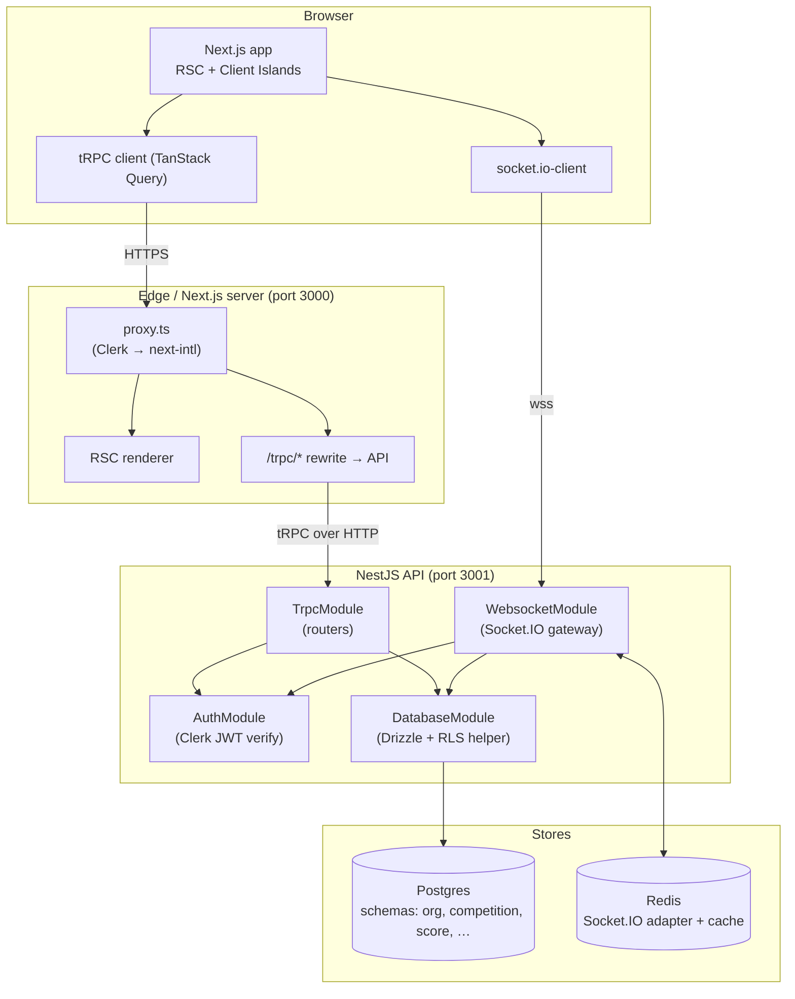
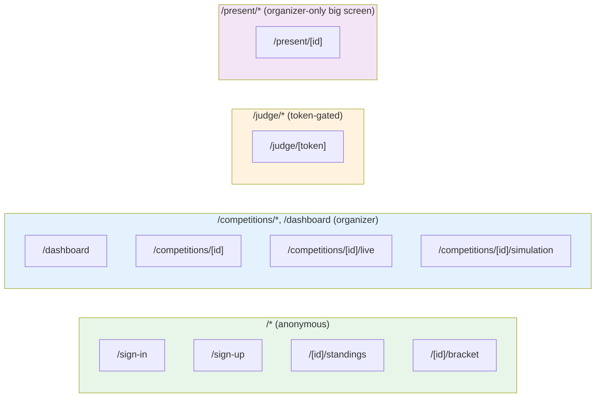
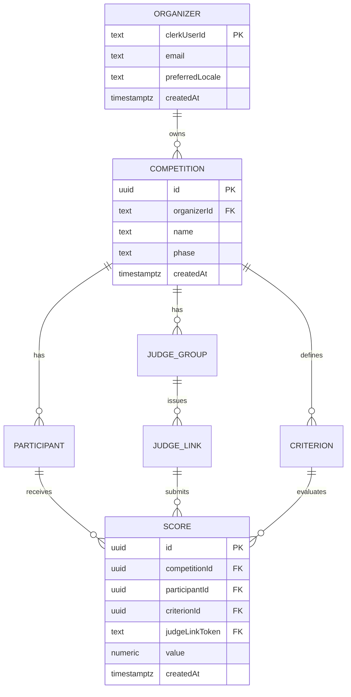
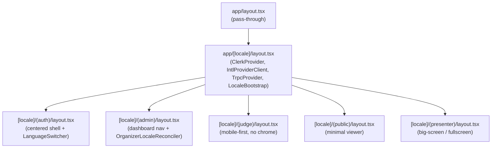
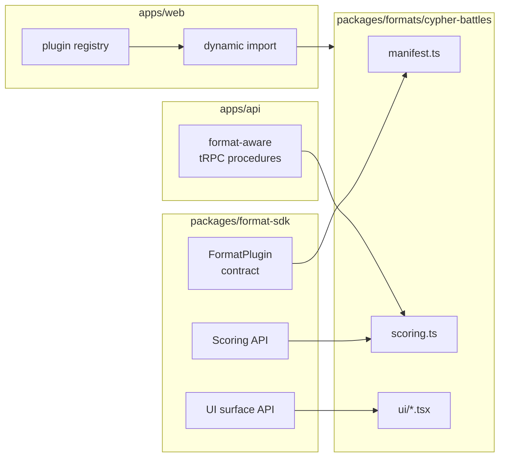
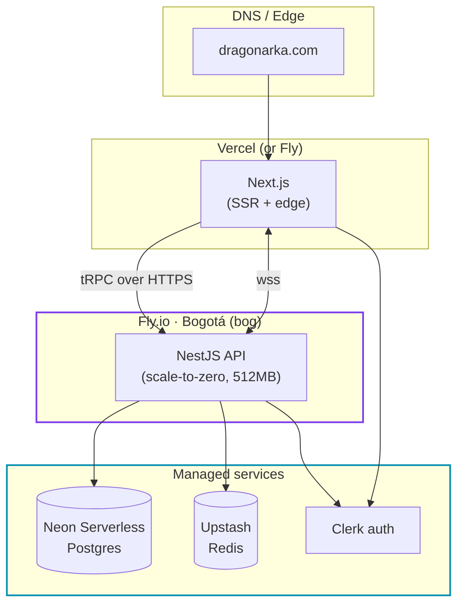

# Architecture

Modular monolith. One Next.js process, one NestJS process, one Postgres, one Redis. tRPC for type-safe request/response, Socket.IO for live updates, Clerk for auth, Drizzle for data with row-level security at every protected procedure.

---

## 1. System view



### Why this shape

- **One API process** keeps deploys simple and shares the in-memory tRPC schema. Splitting into microservices isn't justified until horizontal-scale signals appear.
- **tRPC end-to-end** means web and api share the exact same types and validators. No drift, no codegen.
- **Socket.IO via Redis adapter** lets us horizontally scale the WebSocket layer later without rewriting clients.
- **RLS at the DB** means even a code bug can't leak data across organizers — Postgres refuses.

---

## 2. Routes and roles



next-intl locale strategy is `as-needed`: English routes have no prefix; Spanish routes are prefixed `/es/`. Clerk's `createRouteMatcher` in `apps/web/src/proxy.ts` lists every protected path explicitly per-locale because path-to-regexp v6 doesn't support `?` on unnamed groups.

---

## 3. Real-time scoring flow

The hot path. From "judge taps score" to "every public viewer sees the new standings" must complete in under 500ms (NFR1).

```mermaid
sequenceDiagram
    autonumber
    participant J as Judge (mobile)
    participant W as Next.js (web)
    participant A as NestJS (api)
    participant DB as Postgres
    participant R as Redis
    participant P as Public viewer

    J->>W: Tap score (UI)
    W->>A: tRPC score.submit
    A->>A: Clerk JWT verify + role check
    A->>DB: BEGIN tx; SET LOCAL session.current_organizer_id; INSERT score
    DB-->>A: commit ✓
    A->>R: publish score.updated {compId, …}
    R-->>A: ack
    A-->>W: { ok: true }
    W-->>J: optimistic UI confirmed

    R->>A: deliver to every Socket.IO node
    A-->>P: ws emit 'score.updated'
    P->>P: re-render standings (<10ms)
```

Why Redis pub/sub between API instances: when the WebSocket fleet scales out, each instance must broadcast to clients connected to _other_ instances. The Redis adapter is the industry-standard way.

---

## 4. Data model — high level



(Simplified — see `packages/db/src/schema` for the full set.)

RLS policy on every protected table: `current_setting('session.current_organizer_id') = organizerId`. The helper `withOrganizer(clerkUserId, fn)` in `packages/db` is the only correct way to call queries.

---

## 5. Front-end composition



Every route group has its own layout with role-appropriate chrome. Shared providers (Intl, Clerk, tRPC) live in the locale layout so they wrap everything.

---

## 6. Format plugin architecture

Competition formats (e.g., Cypher Battles) are pluggable modules implementing the `format-sdk` contract. This is a day-one architectural commitment — see [`memory/project_format_plugin_architecture.md`](https://github.com/Dragonarka/competition-platform/blob/main/.claude/projects/-Users-dragonarka-git-competition-platform/memory/project_format_plugin_architecture.md).



Adding a new format = new package under `packages/formats/`. The web app discovers it via the registry; the API consumes its scoring rules through the SDK. No edits to core web/api required.

---

## 7. Deployment topology (target state)



Current state: API config exists but isn't deployed; web has no deploy config; Neon/Upstash aren't provisioned. See [Deploy](./deploy.md) for the unblock checklist.
