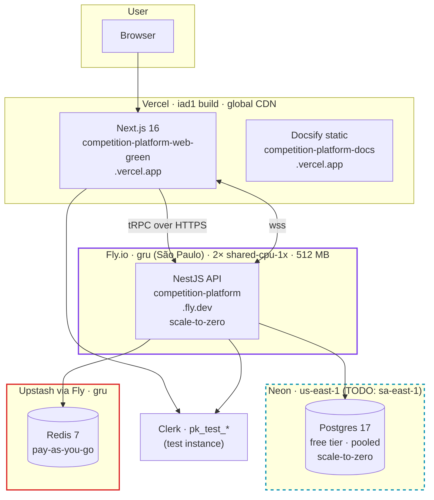

# Deployment — Operational Guide

The stack is **live** as of 2026-05-14. This page is the operational reference: what runs where, how to redeploy, how to rotate secrets, how to add a new region.

For the historical "how we got here" account, see the [Changelog](./changelog.md).

## Current topology



Dashed border = pending migration.

## Day-to-day commands

### Redeploy the API

After pushing to `main`:

```sh
fly deploy --remote-only --app competition-platform
```

Or wire up the GitHub integration so push-to-main auto-deploys via `.github/workflows/deploy.yml` (gated by `ENABLE_DEPLOY=true`).

### Redeploy the web app

From `apps/web/`:

```sh
npx vercel --prod --yes
```

Or wire up the Vercel GitHub integration so push-to-main auto-deploys.

### Tail logs

```sh
fly logs --app competition-platform                 # API
npx vercel logs <deployment-url> -f                 # Web
```

### Connect to the database

```sh
fly mpg connect --cluster <id>                      # (not used currently)
psql "$DATABASE_URL"                                # against Neon directly
```

Or open Neon's web console at <https://console.neon.tech>.

### Connect to Redis

```sh
fly redis connect competition-platform-redis
```

### List/rotate secrets

```sh
fly secrets list --app competition-platform
fly secrets set CLERK_SECRET_KEY="sk_..." --app competition-platform
# Setting any secret triggers a rolling restart.
```

```sh
# Vercel
npx vercel env ls
npx vercel env rm CLERK_SECRET_KEY production
npx vercel env add CLERK_SECRET_KEY production
```

## Configured secrets

### Fly.io (`competition-platform`)

| Key                                 | Why                                                          |
| ----------------------------------- | ------------------------------------------------------------ |
| `DATABASE_URL`                      | Neon **pooled** URL (must include `-pooler` in host)         |
| `REDIS_URL`                         | Upstash URL from `fly redis create`                          |
| `CLERK_SECRET_KEY`                  | Backend JWT verification                                     |
| `NEXT_PUBLIC_CLERK_PUBLISHABLE_KEY` | Set on API too for convenience; only used at build time      |
| `WEB_URL`                           | CORS origin allowlist — must match the Vercel production URL |

### Vercel (web)

| Key                                 | Why                                                                      |
| ----------------------------------- | ------------------------------------------------------------------------ |
| `NEXT_PUBLIC_API_URL`               | `https://competition-platform.fly.dev` — used by client and tRPC rewrite |
| `NEXT_PUBLIC_CLERK_PUBLISHABLE_KEY` | Browser Clerk init                                                       |
| `CLERK_SECRET_KEY`                  | Server-side Clerk verification in middleware                             |

## Common operational tasks

### Pre-warm before a competition

Both API (Fly) and DB (Neon) scale to zero. Cold start is ~3.5s on API + ~1-3s on Neon. To pre-warm:

```sh
curl https://competition-platform.fly.dev/health
# Optional: trigger one tRPC call that hits the DB to wake Neon
```

The first organizer hitting `/sign-in` does this implicitly.

### Migrate Postgres to `sa-east-1` (pending)

```sh
# 1. Create new Neon project in sa-east-1
# 2. Run migrations against it:
DATABASE_URL="<new-direct-url>" pnpm --filter @competition-platform/db db:push

# 3. Dump + restore data if there's any
pg_dump "<old-direct-url>" | psql "<new-direct-url>"

# 4. Swap Fly secret to the new pooled URL
fly secrets set DATABASE_URL="<new-pooled-url>" --app competition-platform

# 5. Wait for rolling restart to finish, then delete the old Neon project.
```

Latency improvement: ~120ms → ~10ms round-trip from Fly `gru` to Neon `sa-east-1`.

### Switch Clerk to production instance

```sh
# In Clerk dashboard: create production instance, verify a domain.
# Get sk_live_* and pk_live_* keys.

fly secrets set CLERK_SECRET_KEY="sk_live_..." \
                NEXT_PUBLIC_CLERK_PUBLISHABLE_KEY="pk_live_..." \
                --app competition-platform

npx vercel env rm NEXT_PUBLIC_CLERK_PUBLISHABLE_KEY production
npx vercel env add NEXT_PUBLIC_CLERK_PUBLISHABLE_KEY production
npx vercel env rm CLERK_SECRET_KEY production
npx vercel env add CLERK_SECRET_KEY production
npx vercel --prod --yes
```

Add the verified domain to Clerk's allowed origins.

### Roll back the API

```sh
fly releases --app competition-platform
fly deploy --image registry.fly.io/competition-platform:<prev-tag> --app competition-platform
```

### Roll back the web

```sh
npx vercel rollback                                 # interactive: pick a previous deployment
# Or promote a specific deployment URL:
npx vercel promote <deployment-url> --prod
```

## Cost reference

| Resource            | Plan                               | Cost                                             |
| ------------------- | ---------------------------------- | ------------------------------------------------ |
| Fly API             | shared-cpu-1x · 512MB · 2 machines | $0 idle (scale-to-zero), pennies per active hour |
| Neon Postgres       | Free                               | $0 (0.5GB · 190 hr compute)                      |
| Upstash Redis       | Pay-as-you-go                      | $0.20 per 100K commands · $0 idle                |
| Vercel (web + docs) | Hobby                              | $0 (free tier)                                   |
| Clerk               | Test                               | $0                                               |

**Total: $0/mo when idle, expected ~$0.10/hr during active competitions.**

## Monitoring

- **Fly logs / metrics**: `fly logs` or <https://fly.io/apps/competition-platform/monitoring>
- **Neon queries / compute**: <https://console.neon.tech>
- **Upstash commands / latency**: <https://console.upstash.com>
- **Vercel function logs**: `npx vercel logs <url> -f`
- **Clerk auth events**: <https://dashboard.clerk.com>

Consider adding Sentry MCP or DataDog once error volume justifies it.

## Docs site

This documentation is rendered by [Docsify](https://docsify.js.org) (client-side markdown) and deployed to Vercel as a static site. The main repo can stay private.

### Deploy a doc change

1. Edit any `.md` in `docs/`.
2. Commit + push to `main`. Vercel's GitHub integration redeploys (once enabled).
3. Or manually: `npx vercel --prod` from the repo root with the docs project's `.vercel/` linked.

### Add a new page

1. Create `docs/your-page.md`.
2. Add to `docs/_sidebar.md`.
3. Commit + push.

Mermaid code blocks (` ```mermaid `) render via the plugin in `docs/index.html`. Search auto-indexes via `docsify-search`.
