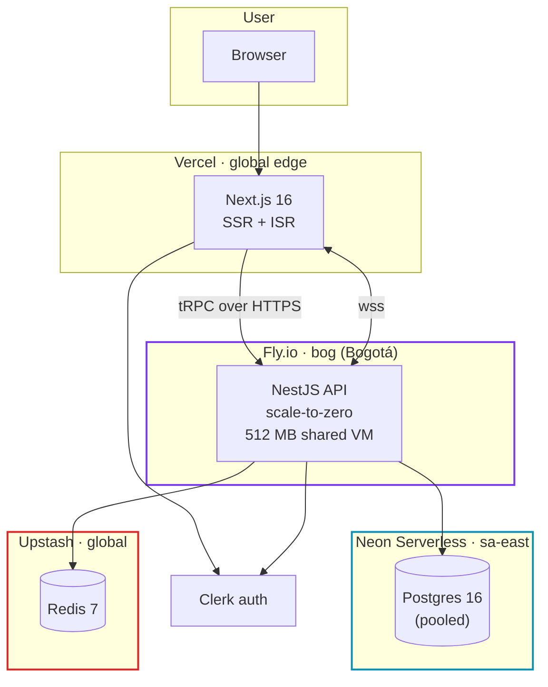

# Deployment

Current state vs. target state, with a concrete unblock checklist.

## Current state

| Component       | Status                       | Where                                  |
| --------------- | ---------------------------- | -------------------------------------- |
| API             | Configured, **not deployed** | `apps/api/Dockerfile`, `fly.toml`      |
| Web             | **No deploy config**         | —                                      |
| Postgres        | Local Docker only            | `docker-compose.yml`                   |
| Redis           | Local Docker only            | `docker-compose.yml`                   |
| Auth            | Clerk dev tenant works       | `.env.local`                           |
| CI pipeline     | Active                       | `.github/workflows/ci.yml`, `test.yml` |
| Deploy pipeline | **Gated off**                | `.github/workflows/deploy.yml`         |

## Target state



## Unblock checklist

### 1. Provision data plane (15–20 min)

| Step            | Where                                                                             | Output                |
| --------------- | --------------------------------------------------------------------------------- | --------------------- |
| Create Postgres | <https://console.neon.tech> → New project (sa-east-1)                             | Pooled `DATABASE_URL` |
| Migrate schema  | locally: `DATABASE_URL=<neon-url> pnpm --filter @competition-platform/db db:push` | Tables created        |
| Create Redis    | <https://console.upstash.com> → New database (Global)                             | `REDIS_URL`           |

### 2. Configure Fly.io (10 min)

```sh
# install flyctl (one-time)
brew install flyctl

# log in and create the app (if not already)
fly auth login
fly apps create competition-platform   # or whatever fly.toml says

# set secrets on the app
fly secrets set \
  DATABASE_URL="<neon-pooled-url>" \
  REDIS_URL="<upstash-url>" \
  CLERK_SECRET_KEY="<sk_live_...>" \
  --app competition-platform

# generate a deploy token for CI
fly tokens create deploy --name github-actions
```

### 3. Wire GitHub secrets/variables

| Type     | Name                                | Value               |
| -------- | ----------------------------------- | ------------------- |
| Variable | `ENABLE_DEPLOY`                     | `true`              |
| Variable | `ENABLE_E2E`                        | `true`              |
| Secret   | `FLY_API_TOKEN`                     | (from step 2)       |
| Secret   | `DATABASE_URL`                      | Neon pooled URL     |
| Secret   | `REDIS_URL`                         | Upstash URL         |
| Secret   | `CLERK_SECRET_KEY`                  | `sk_live_...`       |
| Secret   | `NEXT_PUBLIC_CLERK_PUBLISHABLE_KEY` | `pk_live_...`       |
| Secret   | `TEST_ORGANIZER_EMAIL`              | E2E-only Clerk user |
| Secret   | `TEST_ORGANIZER_PASSWORD`           | E2E-only Clerk user |
| Secret   | `TEST_ORGANIZER_CLERK_USER_ID`      | Clerk user ID       |

Full list: [`ci-secrets-checklist.md`](./ci-secrets-checklist.md).

### 4. Deploy the API

```sh
# manual first deploy
fly deploy --remote-only --app competition-platform

# OR push to main and let deploy.yml do it
git push origin main
```

### 5. Decide web deploy target

| Option                   | Pros                                                                                 | Cons                                                                            |
| ------------------------ | ------------------------------------------------------------------------------------ | ------------------------------------------------------------------------------- |
| **Vercel** (recommended) | Zero-config Next.js 16, edge SSR, ISR, automatic preview deploys, free tier generous | Vendor-lock on edge features; tunnel from edge → Fly API has cold-start latency |
| **Fly.io** (second app)  | Co-located with API in Bogotá; lower latency tRPC; one provider                      | Need a second `Dockerfile` + `fly.toml.web`; no edge ISR; manual prev deploys   |

Recommended path: Vercel for v1 (ship fast), reconsider if tRPC latency from Vercel edge → Fly Bogotá becomes an issue.

For Vercel:

```sh
# from repo root
npx vercel link              # connect the Next.js app
npx vercel env add CLERK_SECRET_KEY production
# add all NEXT_PUBLIC_* + NEXT_PUBLIC_API_URL pointing at Fly app
npx vercel --prod
```

Then add the Vercel URL to Clerk → Paths → Allowed origins.

## Rollback

```sh
# Fly: rollback to previous image
fly releases --app competition-platform
fly deploy --image registry.fly.io/competition-platform:<prev-tag>

# Vercel: promote a previous deployment via dashboard or `vercel rollback`
```

## Monitoring (post-deploy)

- Fly logs: `fly logs --app competition-platform`
- Fly metrics: <https://fly.io/apps/competition-platform/monitoring>
- Neon: built-in query insights at console.neon.tech
- Add Sentry MCP or DataDog when error volume justifies it
