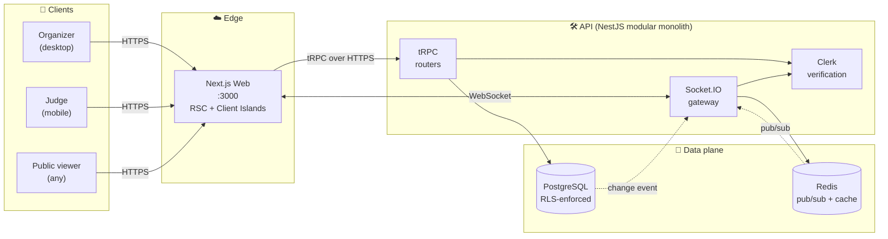

# Competition Platform

Real-time WebSocket competition platform with game theory fairness. Built as a TypeScript monorepo on Next.js 16 + NestJS 11.

> **TL;DR** — Organizers run live competitions. Judges score on phones. Players see real-time standings. WebSockets push every score change to every viewer in <500ms.

## How it all fits together



## Read next

| Page                                              | What's in it                                                     |
| ------------------------------------------------- | ---------------------------------------------------------------- |
| [Architecture](./architecture.md)                 | System, data, real-time flows. Mermaid diagrams for every layer. |
| [Workflows](./workflows.md)                       | BMAD-method pipeline: brief → PRD → story → ship.                |
| [CI/CD](./ci.md)                                  | GitHub Actions workflows + quality gates.                        |
| [CI secrets checklist](./ci-secrets-checklist.md) | What to set in GitHub Settings before first CI run.              |
| [Deploy](./deploy.md)                             | Fly.io API, web target decision, Neon, Upstash.                  |
| [Troubleshooting](./troubleshooting.md)           | Known quirks and their fixes.                                    |

## At a glance

| Aspect        | Value                                               |
| ------------- | --------------------------------------------------- |
| Languages     | TypeScript (strict) end-to-end                      |
| Frontend      | Next.js 16 (Turbopack) + React 19 + Tailwind 4      |
| Backend       | NestJS 11 + tRPC + Socket.IO                        |
| Data          | PostgreSQL 16 (Drizzle ORM, RLS) + Redis 7          |
| Auth          | Clerk                                               |
| i18n          | next-intl (English + Spanish, `as-needed` strategy) |
| Build         | pnpm 9 + Turborepo                                  |
| Tests         | Vitest (unit) + Playwright (E2E, 5 projects)        |
| Deploy target | Fly.io (Bogotá) for API; web TBD                    |

## Quickstart

```sh
pnpm setup        # idempotent first-time bootstrap
# add CLERK_* keys to .env.local
pnpm dev          # http://localhost:3000
```

Full instructions: [README](https://github.com/Dragonarka/competition-platform#quickstart).
