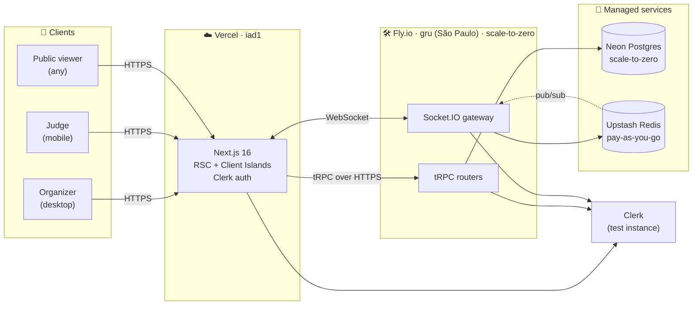

# Competition Platform

Real-time WebSocket competition platform with game theory fairness. TypeScript monorepo · Next.js 16 + NestJS 11.

> **TL;DR** — Organizers run live competitions. Judges score on phones. Players see real-time standings. WebSockets push every score change to every viewer in <500ms.

## 🟢 Live

| Component | URL                                                 |
| --------- | --------------------------------------------------- |
| Web       | <https://competition-platform-web-green.vercel.app> |
| API       | <https://competition-platform.fly.dev>              |
| Docs      | <https://competition-platform-docs.vercel.app>      |

First deploy: **May 13–14, 2026** → see the [Changelog](./changelog.md) for the full story.

## How it all fits together



## Read next

| Page                                    | What's in it                                                            |
| --------------------------------------- | ----------------------------------------------------------------------- |
| [Changelog](./changelog.md)             | What changed in the first production deploy (bugs found, fixes shipped) |
| [Architecture](./architecture.md)       | System, data, real-time flows. Mermaid diagrams for every layer.        |
| [Workflows](./workflows.md)             | BMAD-method pipeline: brief → PRD → story → ship.                       |
| [CI/CD](./ci.md)                        | GitHub Actions workflows + quality gates.                               |
| [Deploy](./deploy.md)                   | Operational guide — secrets, region, redeploys.                         |
| [Troubleshooting](./troubleshooting.md) | Known quirks and their fixes.                                           |

## At a glance

| Aspect    | Value                                                    |
| --------- | -------------------------------------------------------- |
| Languages | TypeScript (strict) end-to-end                           |
| Frontend  | Next.js 16 (Turbopack dev) + React 19 + Tailwind 4       |
| Backend   | NestJS 11 + tRPC + Socket.IO                             |
| Data      | Postgres 17 (Neon, Drizzle ORM, RLS) + Redis 7 (Upstash) |
| Auth      | Clerk                                                    |
| i18n      | next-intl (English + Spanish, `as-needed` strategy)      |
| Build     | pnpm 9 + Turborepo (workspace packages compiled to CJS)  |
| Tests     | Vitest (unit) + Playwright (E2E, 5 projects)             |
| Hosting   | Fly.io (API · gru) · Vercel (web + docs)                 |

## Cost model

Idle: **$0/mo**. The whole stack is scale-to-zero.

| Layer    | Idle                          | Active competition      |
| -------- | ----------------------------- | ----------------------- |
| API      | $0 (Fly auto-stop)            | ~$0.10/hr               |
| DB       | $0 (Neon free tier suspended) | $0 (still free tier)    |
| Redis    | $0 (Upstash pay-per-request)  | ~$0.001 per 1K commands |
| Web/Docs | $0 (Vercel free tier)         | $0                      |

## Quickstart (local dev)

```sh
pnpm setup        # idempotent first-time bootstrap
# add CLERK_* keys to .env.local
pnpm dev          # http://localhost:3000
```

Full instructions: [README](https://github.com/Dragonarka/competition-platform#quickstart).
