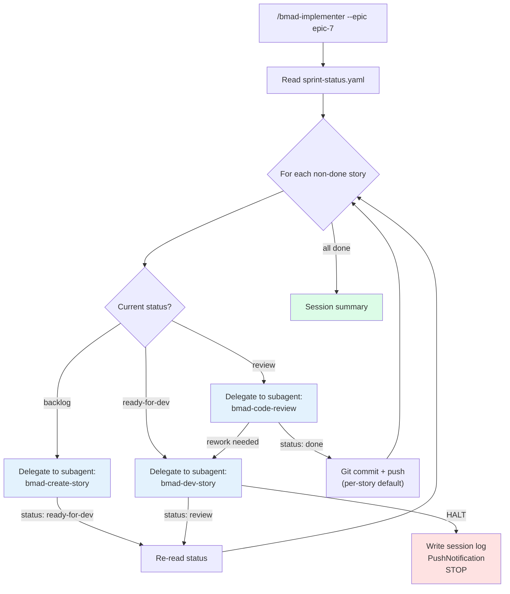
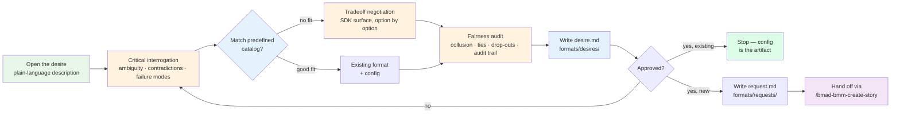
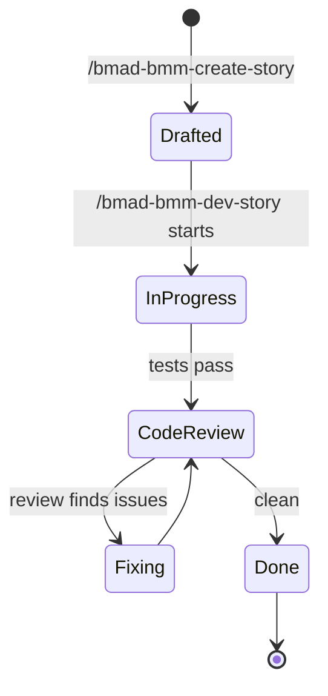
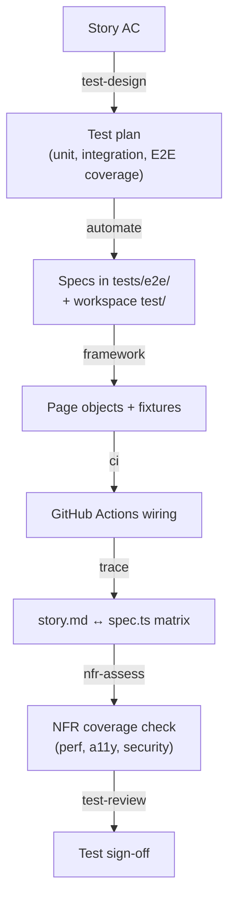

# How we ship — BMAD workflows

The project runs on the [BMAD-method](https://github.com/bmad-code-org/BMAD-METHOD) — a structured workflow system for AI-assisted software development. Each phase has a slash-command skill that produces a concrete artifact. Outputs land in `_bmad-output/` and are committed alongside code.

## The pipeline

```mermaid
flowchart LR
    Brief["Product brief<br/>/bmad-bmm-create-product-brief"] --> PRD
    PRD["PRD<br/>/bmad-bmm-create-prd"] --> Arch
    Arch["Architecture<br/>/bmad-bmm-create-architecture"] --> Epic
    Epic["Epic plan<br/>/bmad-bmm-create-epic"] --> Story
    Story["Story file<br/>/bmad-bmm-create-story"] --> Dev
    Dev["Dev execution<br/>/bmad-bmm-dev-story"] --> Test
    Test["Test design<br/>/bmad-tea-testarch-test-design"] --> Trace
    Trace["Traceability<br/>/bmad-tea-testarch-trace"] --> Review
    Review["Code review<br/>/bmad-bmm-code-review"] --> Retro
    Retro["Epic retro<br/>/bmad-bmm-epic-retro"]

    style Brief fill:#e8f5e9
    style PRD fill:#e8f5e9
    style Arch fill:#e8f5e9
    style Epic fill:#e3f2fd
    style Story fill:#e3f2fd
    style Dev fill:#fff3e0
    style Test fill:#fff3e0
    style Trace fill:#fff3e0
    style Review fill:#f3e5f5
    style Retro fill:#f3e5f5
```



Color legend:

- 🟢 Planning (brief, PRD, architecture)
- 🔵 Story scoping (epic, story)
- 🟠 Execution + testing
- 🟣 Review and retrospective

## Where the artifacts live

```
_bmad-output/
├── planning-artifacts/
│   ├── product-brief.md
│   ├── prd.md
│   └── architecture.md
├── epics/
│   ├── epic-7-simulation.md
│   └── epic-8-i18n.md
├── stories/
│   ├── story-7.2-simulation-panel.md
│   └── story-8.2-language-switcher.md
├── retrospectives/
│   ├── epic-7-retro.md
│   └── epic-8-retro.md
├── test-artifacts/
│   ├── framework-setup-progress.md
│   └── ci-pipeline-progress.md
└── sprint-status.yaml
```

## Most-used skills

> 📌 **As of 2026-05-15 (BMAD 6.6.0)** the slash commands no longer carry the `-bmm-` middle segment. Use `/bmad-create-story`, not `/bmad-bmm-create-story`.

| Skill                        | When to use                                                     |
| ---------------------------- | --------------------------------------------------------------- |
| `/bmad-help`                 | See the full catalog and your current progress                  |
| `/bmad-sprint-status`        | Surface current sprint state + risks (read-only)                |
| `/bmad-sprint-planning`      | Generate `sprint-status.yaml` from epics                        |
| `/bmad-create-story`         | Scope a new story (AC, tech notes, tasks)                       |
| `/bmad-dev-story`            | Execute a story end-to-end (autonomous by design)               |
| `/bmad-quick-dev`            | Small enhancement that doesn't need a story                     |
| `/bmad-code-review`          | Adversarial review (3 parallel layers)                          |
| `/bmad-checkpoint-preview`   | LLM-assisted human-in-the-loop review                           |
| `/bmad-correct-course`       | Course-correction when stories or scope drift                   |
| `/bmad-testarch-framework`   | Scaffold or extend Playwright infra                             |
| `/bmad-testarch-ci`          | Generate or repair GitHub Actions                               |
| `/bmad-testarch-trace`       | Build a story↔test traceability matrix (JSON output as of 1.17) |
| `/bmad-testarch-test-design` | Plan tests before implementing                                  |
| `/bmad-testarch-atdd`        | Acceptance-test-driven development                              |
| `/bmad-retrospective`        | Run a multi-agent retrospective on an epic                      |
| `/bmad-implementer`          | **NEW** — auto-mode orchestrator for the full chain (see below) |

Slash commands are case-sensitive; tab-complete in Claude Code.

## Auto-mode chain orchestrator (`/bmad-implementer`)

A project-local skill that drives the BMAD chain in full-auto. Pass `--story <id>`, `--epic <id>`, or `--all`. Every sub-workflow (`bmad-create-story`, `bmad-dev-story`, `bmad-code-review`) runs in a **fresh subagent** so the orchestrator's context stays slim and BMAD's "fresh context per step" doctrine is honored.



### Invocation examples

| Command                                                             | What runs                                |
| ------------------------------------------------------------------- | ---------------------------------------- |
| `/bmad-implementer --story 3-3-judge-scoring-interface-cypher-mode` | One story, current state → done          |
| `/bmad-implementer --epic epic-7`                                   | Every non-done story in epic-7, in order |
| `/bmad-implementer --all`                                           | Drain everything not done, epic by epic  |

### Pause conditions (auto-mode CAN'T skip these)

- BMAD's existing dev-story HALTs: new deps, ambiguous AC, 3 consecutive subtask failures, CI failures
- More than `--max-rework-rounds` (default 2) of code-review finding new blockers
- State corruption (subagent claims a status that disagrees with `sprint-status.yaml`)
- Dirty working tree at session start, or not on `main`

On any pause: writes `.claude/workflows/bmad-implementer/sessions/session-<date>.md`, fires `PushNotification`, ends the turn cleanly. User resolves and re-invokes.

### What it never does

- Touches `_bmad/` content (vendor territory; gets overwritten on upgrade)
- Reads project source code in its own context (the dev-story subagent's job)
- Production deploys (explicit human gate)
- Cross-epic refactors not in any story scope

Full reference: [`.claude/workflows/bmad-implementer/orchestrator-guide.md`](https://github.com/Dragonarka/competition-platform/blob/main/.claude/workflows/bmad-implementer/orchestrator-guide.md) and the [state machine](https://github.com/Dragonarka/competition-platform/blob/main/.claude/workflows/bmad-implementer/state-machine.md).

## Format design workflow (project-specific)

Adding a new competition format goes through a dedicated conversational design flow before any code is written. An AI agent interviews the requester, challenges vague terms, surfaces tradeoffs they didn't see, audits for fairness gaps, and produces a structured `desire.md` plus (if needed) a `format-request.md` implementation ticket.



Invoke with `/desire-a-format`. The agent's persona is **curious, skeptical, fairness-first, candid** — explicitly _not_ a yes-machine. It won't accept "fair" as a final answer, won't let you have both sides of a tradeoff, and won't propose a new format until it has matched against the predefined catalog.

| Step                                                 | What                                                 |
| ---------------------------------------------------- | ---------------------------------------------------- |
| `/desire-a-format` (Claude Code)                     | Triggers the slash command                           |
| Loads `formats/skill/conversation-guide.md`          | The agent's full instruction set                     |
| Reads `formats/predefined/*.md`                      | 5 catalog briefs (cypher-battles shipped, 4 planned) |
| Writes `formats/desires/desire-YYYY-MM-DD-<slug>.md` | The agreed model + conversation record               |
| Optionally writes `formats/requests/request-*.md`    | Implementation ticket for new formats                |

Outputs are committed alongside the rest of the planning work. Full reference: [`formats/README.md`](https://github.com/Dragonarka/competition-platform/blob/main/formats/README.md).

**Initial state vs eventual:** today this is an internal-only design tool. The conversation patterns, predefined catalog, and templates that prove themselves here become the basis for an organizer-facing format wizard in the web app later.

## Story lifecycle



The `sprint-status.yaml` is the source of truth for which story is in which state. `quick-dev` mutates it idempotently — don't hand-edit unless you mean to override.

## Test architecture pipeline



Each step has its own skill (e.g., `/bmad-tea-testarch-test-design`, `/bmad-tea-testarch-automate`). Progress is tracked in `_bmad-output/test-artifacts/*-progress.md` so re-running a skill resumes instead of starting over.

## Memory and conventions

- `_bmad-output/sprint-status.yaml` — current sprint state (one source of truth)
- `memory/` — persistent context for AI agents (project decisions, user preferences)
- `_bmad/` — the workflow definitions themselves (don't hand-edit unless you understand the impact; upgrade via `npx bmad-method install`)
