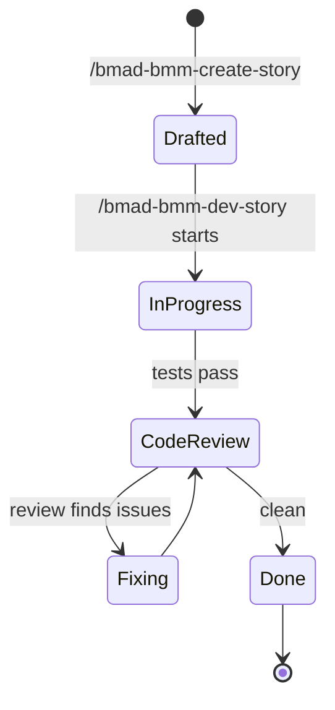
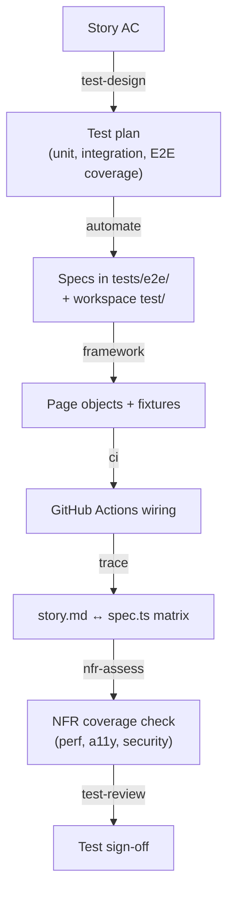

# How we ship — BMAD workflows

The project runs on the [BMAD-method](https://github.com/bmad-code-org/BMAD-METHOD) — a structured workflow system for AI-assisted software development. Each phase has a slash-command skill that produces a concrete artifact. Outputs land in `_bmad-output/` and are committed alongside code.

## The pipeline

```mermaid
flowchart LR
    Brief["Product brief<br/>/bmad-bmm-create-product-brief"] --> PRD
    PRD["PRD<br/>/bmad-bmm-create-prd"] --> Arch
    Arch["Architecture<br/>/bmad-bmm-create-architecture"] --> Epic
    Epic["Epic plan<br/>/bmad-bmm-create-epic"] --> Story
    Story["Story file<br/>/bmad-bmm-create-story"] --> Dev
    Dev["Dev execution<br/>/bmad-bmm-dev-story"] --> Test
    Test["Test design<br/>/bmad-tea-testarch-test-design"] --> Trace
    Trace["Traceability<br/>/bmad-tea-testarch-trace"] --> Review
    Review["Code review<br/>/bmad-bmm-code-review"] --> Retro
    Retro["Epic retro<br/>/bmad-bmm-epic-retro"]

    style Brief fill:#e8f5e9
    style PRD fill:#e8f5e9
    style Arch fill:#e8f5e9
    style Epic fill:#e3f2fd
    style Story fill:#e3f2fd
    style Dev fill:#fff3e0
    style Test fill:#fff3e0
    style Trace fill:#fff3e0
    style Review fill:#f3e5f5
    style Retro fill:#f3e5f5
```



Color legend:

- 🟢 Planning (brief, PRD, architecture)
- 🔵 Story scoping (epic, story)
- 🟠 Execution + testing
- 🟣 Review and retrospective

## Where the artifacts live

```
_bmad-output/
├── planning-artifacts/
│   ├── product-brief.md
│   ├── prd.md
│   └── architecture.md
├── epics/
│   ├── epic-7-simulation.md
│   └── epic-8-i18n.md
├── stories/
│   ├── story-7.2-simulation-panel.md
│   └── story-8.2-language-switcher.md
├── retrospectives/
│   ├── epic-7-retro.md
│   └── epic-8-retro.md
├── test-artifacts/
│   ├── framework-setup-progress.md
│   └── ci-pipeline-progress.md
└── sprint-status.yaml
```

## Most-used skills

| Skill                            | When to use                                    |
| -------------------------------- | ---------------------------------------------- |
| `/bmad-help`                     | See the full catalog and your current progress |
| `/bmad-bmm-create-story`         | Scope a new story (AC, tech notes, tasks)      |
| `/bmad-bmm-dev-story`            | Execute a story end-to-end                     |
| `/bmad-bmm-quick-dev`            | Small enhancement that doesn't need a story    |
| `/bmad-bmm-code-review`          | Adversarial review before commit               |
| `/bmad-tea-testarch-framework`   | Scaffold or extend Playwright infra            |
| `/bmad-tea-testarch-ci`          | Generate or repair GitHub Actions              |
| `/bmad-tea-testarch-trace`       | Build a story↔test traceability matrix         |
| `/bmad-tea-testarch-test-design` | Plan tests before implementing                 |
| `/bmad-tea-testarch-atdd`        | Acceptance-test-driven development             |
| `/bmad-bmm-epic-retro`           | Run a multi-agent retrospective on an epic     |

Slash commands are case-sensitive; tab-complete in Claude Code.

## Story lifecycle



The `sprint-status.yaml` is the source of truth for which story is in which state. `quick-dev` mutates it idempotently — don't hand-edit unless you mean to override.

## Test architecture pipeline



Each step has its own skill (e.g., `/bmad-tea-testarch-test-design`, `/bmad-tea-testarch-automate`). Progress is tracked in `_bmad-output/test-artifacts/*-progress.md` so re-running a skill resumes instead of starting over.

## Memory and conventions

- `_bmad-output/sprint-status.yaml` — current sprint state (one source of truth)
- `memory/` — persistent context for AI agents (project decisions, user preferences)
- `_bmad/` — the workflow definitions themselves (don't hand-edit unless you understand the impact; upgrade via `npx bmad-method install`)
